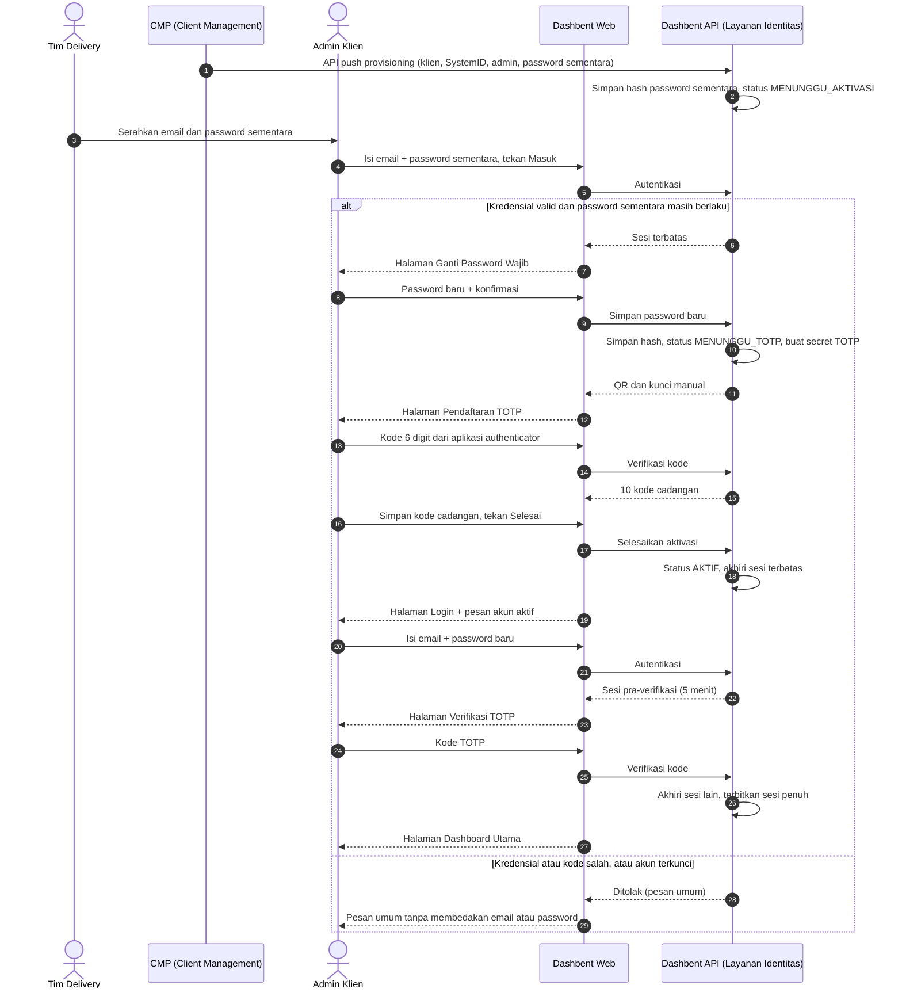
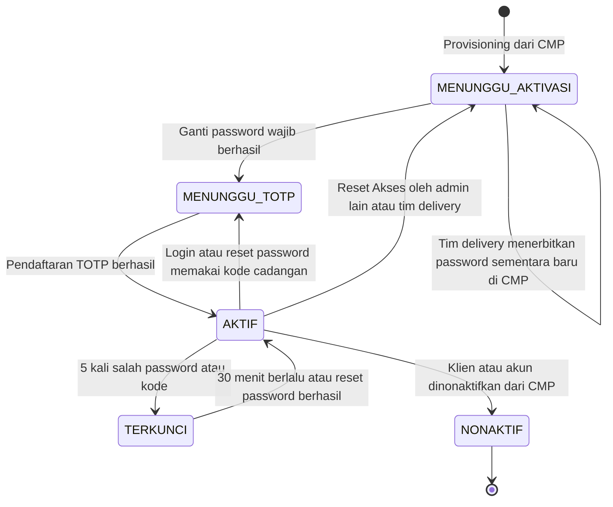

# PRD \- Dashbent Backoffice: Initiate Login, Login Biasa, dan Lupa Password

PRD ini mengacu pada IDDS Comprehensive Acceptance Criteria - <https://docs.google.com/document/d/18fUoTIbROnvLQZ69R25EDcmTUK183va4HQk9tspsQsw/edit?usp=sharing> Poin User Acceptance yang menerapkan standar IDDS diberi label `based on IDDS`.

---

## 📑 Metadata Dokumen

| Attribute           | Details                                                                                                                                                 |
| ------------------- | ------------------------------------------------------------------------------------------------------------------------------------------------------- |
| **Feature Name**    | Login & Aktivasi Akun Dashbent Backoffice (login awal, ganti password wajib, pendaftaran TOTP, login dengan TOTP, sesi, lupa password, pemulihan akses) |
| **Document Status** | DRAFT                                                                                                                                                   |

---

## 🧩 Latar Belakang (Background & Context)

Dashbent direvamp menjadi satu backoffice untuk semua klien enterprise Peruri, dengan akses yang dipisah per SystemID. Klien tidak mendaftar sendiri. Tim delivery Peruri membuat klien, SystemID, dan akun admin pertama di Client Management pada Central Management Portal (CMP). CMP mengirim data tersebut ke Dashbent lewat API push dan mengeluarkan password sementara untuk admin klien. Untuk saat ini, tim delivery menyerahkan email dan password sementara itu kepada admin klien secara langsung.

Admin klien memakai password sementara hanya sekali. Saat login pertama, sistem mewajibkan admin membuat password sendiri dan mendaftarkan TOTP di aplikasi authenticator seperti Google Authenticator, mengakhiri sesi, lalu meminta admin login ulang. Setelah itu admin memakai login biasa dengan email, password, dan kode TOTP. Akun Dashbent terpisah dari akun Digidoc dan portal Peruri lain sampai SSO tersedia.

- **Masalah Utama:** Dashbent saat ini tidak memiliki alur aktivasi akun. Kredensial awal yang dibuat tim Peruri tidak dipaksa diganti, tidak ada aturan pemakaian sekali, dan tidak ada proteksi brute force yang terdokumentasi. Backoffice baru dapat me-revoke sertifikat dan menyetujui dasar tagihan, sehingga pintu masuknya harus lebih ketat dari dashboard read-only.
- **Solusi yang Ditawarkan:** Halaman Login yang membedakan login awal dan login biasa berdasarkan status akun, Halaman Ganti Password Wajib dengan aturan password standar IDDS, verifikasi dua langkah dengan TOTP yang didaftarkan saat aktivasi beserta 10 kode cadangan, lockout setelah 5 kali salah password atau kode, rate limit per IP, satu sesi aktif per akun dengan idle timeout 30 menit, serta pemulihan akses bertingkat: lupa password lewat tautan email dan kode TOTP, kode cadangan saat perangkat hilang, Reset Akses oleh admin lain, dan bantuan tim delivery sebagai jalur terakhir.
- **Dampak Bisnis / Value:** Tim delivery tidak lagi mengetahui password yang dipakai admin klien setelah aktivasi. Setiap akses ke backoffice tercatat dan dapat diaudit. Pembobolan email atau password admin saja tidak cukup untuk mengambil alih akun. Admin klien dapat memulihkan akses sendiri lewat lupa password tanpa menghubungi tim delivery, dan tim delivery hanya turun tangan saat admin satu-satunya kehilangan perangkat dan kode cadangan.
- **Batasan Cakupan:** PRD ini tidak mencakup pembuatan akun dan password sementara di CMP (PRD Client Management CMP), pengiriman password sementara otomatis ke email admin (roadmap), SSO lintas platform (roadmap), pengelolaan user lain dan tombol Reset Akses oleh Client Admin (PRD User & Akses), reset akses oleh tim delivery di CMP beserta prosedur verifikasinya (PRD Client Management CMP), penggantian perangkat authenticator dan pembuatan ulang kode cadangan dari menu Pengaturan (PRD Pengaturan), serta isi Halaman Dashboard Utama setelah login (PRD Dashboard). Pilihan untuk melewati TOTP di perangkat yang sama tidak disediakan.

---

## 📊 User Flow / System Architecture

**Alur login awal sampai login biasa**

**Status akun**

---

## 🎯 Fitur Mapping (Feature Output Mapping)

| Fitur / Sub-Modul                            | Halaman Tujuan / Output System                                  | Deskripsi Singkat                                                                                                                                                                                                    |
| -------------------------------------------- | --------------------------------------------------------------- | -------------------------------------------------------------------------------------------------------------------------------------------------------------------------------------------------------------------- |
| **\[FR-001\] Login Awal**                    | Halaman Login, Halaman Ganti Password Wajib                     | Admin dengan status MENUNGGU\_AKTIVASI masuk memakai email dan password sementara, lalu diarahkan ke Halaman Ganti Password Wajib dengan sesi terbatas.                                                              |
| **\[FR-002\] Ganti Password Wajib**          | Halaman Ganti Password Wajib                                    | Admin membuat password baru sesuai aturan. Status akun berubah menjadi MENUNGGU\_TOTP.                                                                                                                               |
| **\[FR-003\] Pendaftaran TOTP dan Aktivasi** | Halaman Pendaftaran TOTP, Halaman Login                         | Admin memindai QR dengan aplikasi authenticator, memverifikasi kode, dan menyimpan 10 kode cadangan. Status akun menjadi AKTIF dan sesi diakhiri.                                                                    |
| **\[FR-004\] Login Biasa dengan TOTP**       | Halaman Login, Halaman Verifikasi TOTP, Halaman Dashboard Utama | User berstatus AKTIF masuk dengan email dan password, lalu memasukkan kode TOTP atau kode cadangan sebelum diarahkan ke Halaman Dashboard Utama.                                                                     |
| **\[FR-005\] Proteksi Akun**                 | Halaman Login, Halaman Verifikasi TOTP                          | Pesan umum untuk kredensial salah, lockout 30 menit setelah 5 kali salah password atau kode, rate limit per IP, penolakan password sementara yang sudah diganti atau diterbitkan ulang, dan penolakan akun nonaktif. |
| **\[FR-006\] Sesi dan Logout**               | Seluruh halaman setelah login, Modal Peringatan Sesi            | Satu sesi aktif per akun, idle timeout 30 menit dengan peringatan, dan logout.                                                                                                                                       |
| **\[FR-007\] Lupa Password dengan TOTP**     | Halaman Lupa Password, email reset, Halaman Atur Ulang Password | User meminta tautan reset ke email, memverifikasi kode TOTP atau kode cadangan, lalu membuat password baru.                                                                                                          |
| **\[FR-008\] Pemulihan Akses**               | Status akun di Dashbent, dipicu dari User & Akses atau CMP      | Saat perangkat dan kode cadangan hilang, admin lain atau tim delivery mereset akses sehingga user kembali ke alur login awal.                                                                                        |
| **\[FR-009\] Audit Trail Autentikasi**       | Audit Trail Dashbent                                            | Sistem mencatat setiap peristiwa autentikasi: login, verifikasi TOTP, aktivasi, lockout, sesi, reset password, dan reset akses.                                                                                      |

---

## 📑 User Story & User Acceptance Criteria

### \[US-001\] Login Awal dengan Password Sementara

| Point               | Deskripsi                                                                                                                                                                                                                                                                                                                                                                                                                                                                                                                                                                                                                                                                                                                                                                                                                                                                                                                                                                                                                                                                                                                                                                                                                                                                                                                                                                                                                                                                                                                                                                                                                                                                                                                                                                                                                                                                                                                                                                                                                                                                                                                                                                                                                                                                                                                                                                                                                                                                                                                                                                                                                                                                                                                                                                                                                                                                                                                                                                                                                                                                                                                                                                                                                                                                                                                                                                                                                                                                                                                                                                                                                                                                                                                                                                                                                                                                                                                                                                                                                                                                                                                                                                                                                                                                                                                                                                            |
| ------------------- | ------------------------------------------------------------------------------------------------------------------------------------------------------------------------------------------------------------------------------------------------------------------------------------------------------------------------------------------------------------------------------------------------------------------------------------------------------------------------------------------------------------------------------------------------------------------------------------------------------------------------------------------------------------------------------------------------------------------------------------------------------------------------------------------------------------------------------------------------------------------------------------------------------------------------------------------------------------------------------------------------------------------------------------------------------------------------------------------------------------------------------------------------------------------------------------------------------------------------------------------------------------------------------------------------------------------------------------------------------------------------------------------------------------------------------------------------------------------------------------------------------------------------------------------------------------------------------------------------------------------------------------------------------------------------------------------------------------------------------------------------------------------------------------------------------------------------------------------------------------------------------------------------------------------------------------------------------------------------------------------------------------------------------------------------------------------------------------------------------------------------------------------------------------------------------------------------------------------------------------------------------------------------------------------------------------------------------------------------------------------------------------------------------------------------------------------------------------------------------------------------------------------------------------------------------------------------------------------------------------------------------------------------------------------------------------------------------------------------------------------------------------------------------------------------------------------------------------------------------------------------------------------------------------------------------------------------------------------------------------------------------------------------------------------------------------------------------------------------------------------------------------------------------------------------------------------------------------------------------------------------------------------------------------------------------------------------------------------------------------------------------------------------------------------------------------------------------------------------------------------------------------------------------------------------------------------------------------------------------------------------------------------------------------------------------------------------------------------------------------------------------------------------------------------------------------------------------------------------------------------------------------------------------------------------------------------------------------------------------------------------------------------------------------------------------------------------------------------------------------------------------------------------------------------------------------------------------------------------------------------------------------------------------------------------------------------------------------------------------------------------------------ |
| **User Story**      | Sebagai **Client Admin yang baru dibuatkan akun oleh tim delivery Peruri**, saya ingin masuk ke Halaman Login Dashbent Backoffice dengan email terdaftar dan password sementara yang diberikan tim delivery agar saya bisa mengaktifkan akun dan mulai mengelola layanan Peruri untuk organisasi saya.                                                                                                                                                                                                                                                                                                                                                                                                                                                                                                                                                                                                                                                                                                                                                                                                                                                                                                                                                                                                                                                                                                                                                                                                                                                                                                                                                                                                                                                                                                                                                                                                                                                                                                                                                                                                                                                                                                                                                                                                                                                                                                                                                                                                                                                                                                                                                                                                                                                                                                                                                                                                                                                                                                                                                                                                                                                                                                                                                                                                                                                                                                                                                                                                                                                                                                                                                                                                                                                                                                                                                                                                                                                                                                                                                                                                                                                                                                                                                                                                                                                                               |
| **User Journey**    | 1. Tim delivery menyerahkan email terdaftar dan password sementara kepada admin klien. 2. Admin membuka Halaman Login Dashbent Backoffice. 3. Admin mengisi Email dan Password, lalu menekan tombol Masuk. 4. Tombol Masuk menampilkan loading dan dinonaktifkan sementara. 5. Frontend mengirim kredensial ke backend lewat HTTPS beserta token CSRF. 6. Backend mencocokkan email dan hash password, lalu membaca status akun. 7. Akun berstatus MENUNGGU\_AKTIVASI dan password sementara masih berlaku, sehingga backend membuat sesi terbatas yang hanya boleh mengakses Halaman Ganti Password Wajib dan Keluar. 8. Sistem mengarahkan admin ke Halaman Ganti Password Wajib. 9. Sistem mencatat audit log login awal.                                                                                                                                                                                                                                                                                                                                                                                                                                                                                                                                                                                                                                                                                                                                                                                                                                                                                                                                                                                                                                                                                                                                                                                                                                                                                                                                                                                                                                                                                                                                                                                                                                                                                                                                                                                                                                                                                                                                                                                                                                                                                                                                                                                                                                                                                                                                                                                                                                                                                                                                                                                                                                                                                                                                                                                                                                                                                                                                                                                                                                                                                                                                                                                                                                                                                                                                                                                                                                                                                                                                                                                                                                                         |
| **User Acceptance** | **1. Validasi Tampilan & State Antarmuka (UI States)** **\[AC-001.1\] Render Halaman Login (Initial State)** • **Given** Admin membuka Halaman Login tanpa sesi aktif • **When** Halaman selesai dimuat • **Then** Sistem menampilkan field Email, field Password yang tersamar dengan tombol tampilkan dan sembunyikan, tombol Masuk, dan tautan Lupa Password, masing-masing dengan label yang terlihat `[based on IDDS: Text Input & Password Field]` • **And** Kursor berada di field Email dan seluruh elemen dapat dioperasikan dengan keyboard dan pembaca layar `[based on IDDS: Accessibility]` **\[AC-001.2\] Status Loading & Proteksi Dobel Klik (Loading State)** • **Given** Admin sudah mengisi Email dan Password • **When** Admin menekan tombol Masuk dan backend sedang memproses • **Then** Tombol Masuk menampilkan spinner dan dinonaktifkan sampai respons diterima `[based on IDDS: Button]` **\[AC-001.3\] Pengalihan ke Halaman Ganti Password Wajib (Success State)** • **Given** Akun berstatus MENUNGGU\_AKTIVASI dan password sementara benar serta masih berlaku • **When** Backend mengembalikan respons sukses • **Then** Sistem mengarahkan admin ke Halaman Ganti Password Wajib dan menampilkan informasi "Untuk keamanan akun, buat password baru sebelum melanjutkan." `[based on IDDS: Alert]` **2. Validasi Data & Logika Bisnis (Data & Logic)** **\[AC-001.4\] Validasi Field Login** • **Given** Admin mengisi form login • **When** Field kehilangan fokus atau admin menekan Masuk • **Then** Sistem memvalidasi Email wajib diisi, berformat email valid, maksimal 254 karakter, dan Password wajib diisi, lalu menampilkan pesan kesalahan di bawah field terkait `[based on IDDS: Email Field & Password Field]` • **And** Backend memvalidasi ulang seluruh input dan melakukan sanitasi sebelum memprosesnya `[based on IDDS: Security]` **\[AC-001.5\] Pembedaan Login Awal oleh Backend** • **Given** Kredensial valid • **When** Backend membaca status akun MENUNGGU\_AKTIVASI • **Then** Backend menerbitkan sesi terbatas yang hanya mengizinkan endpoint ganti password wajib dan keluar • **And** Setiap upaya membuka halaman atau API lain ditolak backend dan frontend mengarahkan admin kembali ke Halaman Ganti Password Wajib `[based on IDDS: Security]` **\[AC-001.6\] Login Awal Berulang Sebelum Aktivasi** • **Given** Admin keluar atau menutup browser sebelum mengganti password • **When** Admin login lagi dengan password sementara yang masih berlaku • **Then** Sistem kembali mengarahkan admin ke Halaman Ganti Password Wajib **3. Validasi Keamanan, Rate Limiting & Sesi (Security & Fraud)** **\[AC-001.7\] Perlindungan Kredensial dan Token Sesi** • **Given** Admin mengirim form login • **When** Frontend mengirim request ke backend • **Then** Kredensial hanya dikirim di body request lewat HTTPS dengan token CSRF, tidak pernah muncul di URL, dan browser tidak menawarkan penyimpanan password sementara `[based on IDDS: Security]` • **And** Backend menyimpan token sesi pada Cookie HttpOnly Secure SameSite `[based on IDDS: Security]` **4. Validasi Audit Trail & Logging (Compliance)** **\[AC-001.8\] Pencatatan Login Awal** • **Given** Login awal berhasil • **When** Sesi terbatas diterbitkan • **Then** Sistem mencatat audit log berisi User ID, email termask, ID klien, Timestamp ISO 8601, Event Type AUTH\_INITIAL\_LOGIN\_SUCCESS, IP Address, user agent, dan status `[based on IDDS: Security]` • **And** Log tidak pernah memuat password atau token sesi `[based on IDDS: Security]` **5. Validasi Kegagalan & Penanganan Error (Error Handling & SLA)** **\[AC-001.9\] Kegagalan Server Saat Login Awal** • **Given** Backend timeout atau mengembalikan error 5xx • **When** Frontend tidak menerima respons sukses • **Then** Sistem menampilkan pesan umum sesuai \[US-010\] tanpa stack trace dan mempertahankan isian Email `[based on IDDS: Alert]` **6. Kinerja (SLA) & Aksesibilitas Fungsional** **\[AC-001.10\] Waktu Respons dan Pembaca Layar** • **Given** Admin menekan Masuk • **When** Backend memproses autentikasi • **Then** Backend merespons dalam maksimal 2 detik untuk 95% request `[based on IDDS: Performance]` • **And** Pesan kesalahan dan informasi pengalihan dibacakan oleh pembaca layar `[based on IDDS: Accessibility]` |

---

### \[US-002\] Ganti Password Wajib

| Point               | Deskripsi                                                                                                                                                                                                                                                                                                                                                                                                                                                                                                                                                                                                                                                                                                                                                                                                                                                                                                                                                                                                                                                                                                                                                                                                                                                                                                                                                                                                                                                                                                                                                                                                                                                                                                                                                                                                                                                                                                                                                                                                                                                                                                                                                                                                                                                                                                                                                                                                                                                                                                                                                                                                                                                                                                                                                                                                                                                                                                                                                                                                                                                                                                                                                                                                                                                                                                                                                                                                                                                                                                                                                                                                                                                                                                                                                                                                                                                                                                                                                                                                                                                                                                                                                                                                                                                                                                                                                                                                                                                                                                                                                                                                                                                                                                                                               |
| ------------------- | ------------------------------------------------------------------------------------------------------------------------------------------------------------------------------------------------------------------------------------------------------------------------------------------------------------------------------------------------------------------------------------------------------------------------------------------------------------------------------------------------------------------------------------------------------------------------------------------------------------------------------------------------------------------------------------------------------------------------------------------------------------------------------------------------------------------------------------------------------------------------------------------------------------------------------------------------------------------------------------------------------------------------------------------------------------------------------------------------------------------------------------------------------------------------------------------------------------------------------------------------------------------------------------------------------------------------------------------------------------------------------------------------------------------------------------------------------------------------------------------------------------------------------------------------------------------------------------------------------------------------------------------------------------------------------------------------------------------------------------------------------------------------------------------------------------------------------------------------------------------------------------------------------------------------------------------------------------------------------------------------------------------------------------------------------------------------------------------------------------------------------------------------------------------------------------------------------------------------------------------------------------------------------------------------------------------------------------------------------------------------------------------------------------------------------------------------------------------------------------------------------------------------------------------------------------------------------------------------------------------------------------------------------------------------------------------------------------------------------------------------------------------------------------------------------------------------------------------------------------------------------------------------------------------------------------------------------------------------------------------------------------------------------------------------------------------------------------------------------------------------------------------------------------------------------------------------------------------------------------------------------------------------------------------------------------------------------------------------------------------------------------------------------------------------------------------------------------------------------------------------------------------------------------------------------------------------------------------------------------------------------------------------------------------------------------------------------------------------------------------------------------------------------------------------------------------------------------------------------------------------------------------------------------------------------------------------------------------------------------------------------------------------------------------------------------------------------------------------------------------------------------------------------------------------------------------------------------------------------------------------------------------------------------------------------------------------------------------------------------------------------------------------------------------------------------------------------------------------------------------------------------------------------------------------------------------------------------------------------------------------------------------------------------------------------------------------------------------------------------------------------- |
| **User Story**      | Sebagai **Client Admin yang masuk dengan password sementara**, saya ingin membuat password baru di Halaman Ganti Password Wajib dengan panduan aturan password yang terlihat agar akun saya hanya bisa dibuka dengan password yang saya tentukan sendiri, bukan password yang diketahui tim delivery.                                                                                                                                                                                                                                                                                                                                                                                                                                                                                                                                                                                                                                                                                                                                                                                                                                                                                                                                                                                                                                                                                                                                                                                                                                                                                                                                                                                                                                                                                                                                                                                                                                                                                                                                                                                                                                                                                                                                                                                                                                                                                                                                                                                                                                                                                                                                                                                                                                                                                                                                                                                                                                                                                                                                                                                                                                                                                                                                                                                                                                                                                                                                                                                                                                                                                                                                                                                                                                                                                                                                                                                                                                                                                                                                                                                                                                                                                                                                                                                                                                                                                                                                                                                                                                                                                                                                                                                                                                                   |
| **User Journey**    | 1. Sistem menampilkan Halaman Ganti Password Wajib setelah login awal berhasil. 2. Halaman menampilkan field Password Baru, field Konfirmasi Password Baru, daftar aturan password, tombol Simpan Password, dan tombol Keluar. Menu navigasi lain tidak ditampilkan. 3. Admin mengisi Password Baru dan Konfirmasi Password Baru. 4. Saat field kehilangan fokus, sistem menandai aturan yang sudah dan belum terpenuhi. 5. Admin menekan Simpan Password. 6. Tombol menampilkan loading dan dinonaktifkan sementara. 7. Backend memvalidasi ulang aturan password, memastikan password baru berbeda dari password sementara, lalu menyimpan hash password baru. 8. Backend mengubah status akun menjadi MENUNGGU\_TOTP dan mengarahkan admin ke Halaman Pendaftaran TOTP dalam sesi terbatas yang sama (\[US-003\]).                                                                                                                                                                                                                                                                                                                                                                                                                                                                                                                                                                                                                                                                                                                                                                                                                                                                                                                                                                                                                                                                                                                                                                                                                                                                                                                                                                                                                                                                                                                                                                                                                                                                                                                                                                                                                                                                                                                                                                                                                                                                                                                                                                                                                                                                                                                                                                                                                                                                                                                                                                                                                                                                                                                                                                                                                                                                                                                                                                                                                                                                                                                                                                                                                                                                                                                                                                                                                                                                                                                                                                                                                                                                                                                                                                                                                                                                                                                                   |
| **User Acceptance** | **1. Validasi Tampilan & State Antarmuka (UI States)** **\[AC-002.1\] Render Halaman Ganti Password Wajib (Initial State)** • **Given** Admin memiliki sesi terbatas dari login awal • **When** Halaman selesai dimuat • **Then** Sistem menampilkan field Password Baru dan Konfirmasi Password Baru yang tersamar dengan tombol tampilkan dan sembunyikan, daftar aturan password sebagai teks bantuan, tombol Simpan Password, dan tombol Keluar `[based on IDDS: Password Field & Button]` • **And** Menu navigasi backoffice tidak ditampilkan pada halaman ini **\[AC-002.2\] Status Loading (Loading State)** • **Given** Admin menekan Simpan Password dengan isian yang valid • **When** Backend sedang memproses • **Then** Tombol Simpan Password menampilkan spinner dan dinonaktifkan sampai respons diterima `[based on IDDS: Button]` **\[AC-002.3\] Pesan Kesalahan Aturan Password (Error State)** • **Given** Isian belum memenuhi aturan • **When** Admin menekan Simpan Password • **Then** Sistem menampilkan pesan kesalahan di bawah field terkait dan ringkasan kesalahan di bagian atas form `[based on IDDS: Form Input & Alert]` **2. Validasi Data & Logika Bisnis (Data & Logic)** **\[AC-002.4\] Aturan Password Baru** • **Given** Admin mengisi Password Baru • **When** Field kehilangan fokus dan saat form dikirim • **Then** Sistem mewajibkan password 12 sampai 128 karakter yang memuat minimal satu huruf besar, satu huruf kecil, satu angka, dan satu simbol, sesuai \[BR-004\] `[based on IDDS: Password Field]` • **And** Sistem menandai setiap aturan yang terpenuhi dengan teks, tidak hanya dengan warna `[based on IDDS: Accessibility]` **\[AC-002.5\] Konfirmasi Password** • **Given** Admin mengisi Konfirmasi Password Baru • **When** Isian tidak sama dengan Password Baru • **Then** Sistem menampilkan pesan "Konfirmasi password tidak sama dengan password baru." di bawah field konfirmasi `[based on IDDS: Form Input]` **\[AC-002.6\] Berbeda dari Password Sementara** • **Given** Admin mengisi Password Baru yang sama dengan password sementara • **When** Backend memvalidasi permintaan • **Then** Backend menolak dengan pesan "Password baru tidak boleh sama dengan password sementara." `[based on IDDS: Security]` **\[AC-002.7\] Validasi Ulang di Backend** • **Given** Frontend mengirim password baru • **When** Backend menerima request • **Then** Backend memvalidasi ulang seluruh aturan \[BR-004\] dan menolak request yang tidak memenuhi aturan meskipun lolos validasi frontend `[based on IDDS: Security]` **3. Validasi Keamanan, Rate Limiting & Sesi (Security & Fraud)** **\[AC-002.8\] Endpoint Hanya untuk Sesi Terbatas yang Valid** • **Given** Request ganti password wajib dikirim tanpa sesi terbatas yang valid, atau dari akun yang sudah AKTIF • **When** Backend memeriksa sesi dan status akun • **Then** Backend menolak request dan frontend mengarahkan user ke Halaman Login `[based on IDDS: Security]` **\[AC-002.9\] Penyimpanan Password Aman** • **Given** Password baru lolos validasi • **When** Backend menyimpan password • **Then** Backend hanya menyimpan hash password dengan algoritma argon2 atau bcrypt, memvalidasi token CSRF, dan tidak pernah mencatat password di log `[based on IDDS: Security]` **4. Validasi Audit Trail & Logging (Compliance)** **\[AC-002.10\] Pencatatan Ganti Password Wajib** • **Given** Password baru tersimpan • **When** Status akun berubah menjadi MENUNGGU\_TOTP • **Then** Sistem mencatat audit log berisi User ID, email termask, ID klien, Timestamp ISO 8601, Event Type AUTH\_PASSWORD\_CHANGED, IP Address, user agent, dan status `[based on IDDS: Security]` **5. Validasi Kegagalan & Penanganan Error (Error Handling & SLA)** **\[AC-002.11\] Gagal Menyimpan Password** • **Given** Backend timeout atau error 5xx saat menyimpan password • **When** Frontend tidak menerima respons sukses • **Then** Sistem menampilkan "Password belum tersimpan. Silakan coba lagi." tanpa stack trace, mengosongkan kedua field password, dan menyediakan tombol Coba Lagi `[based on IDDS: Alert & Button]` • **And** Backend menyimpan password baru dan status MENUNGGU\_TOTP dalam satu transaksi, sehingga status akun tidak berubah bila penyimpanan gagal **6. Kinerja (SLA) & Aksesibilitas Fungsional** **\[AC-002.12\] Waktu Respons dan Pembaca Layar** • **Given** Admin menekan Simpan Password • **When** Backend memproses permintaan • **Then** Backend merespons dalam maksimal 2 detik untuk 95% request `[based on IDDS: Performance]` • **And** Status setiap aturan password dan pesan kesalahan dibacakan oleh pembaca layar `[based on IDDS: Accessibility]` |

---

### \[US-003\] Pendaftaran TOTP dan Aktivasi Akun

| Point               | Deskripsi                                                                                                                                                                                                                                                                                                                                                                                                                                                                                                                                                                                                                                                                                                                                                                                                                                                                                                                                                                                                                                                                                                                                                                                                                                                                                                                                                                                                                                                                                                                                                                                                                                                                                                                                                                                                                                                                                                                                                                                                                                                                                                                                                                                                                                                                                                                                                                                                                                                                                                                                                                                                                                                                                                                                                                                                                                                                                                                                                                                                                                                                                                                                                                                                                                                                                                                                                                                                                                                                                                                                                                                                                                                                                                                                                                                                                                                                                                                                                                                                                                                                                                                                                                                                                                                                                                                                                                                                                                                                                                                                                                                                                                                                                                                                                                                                                                                                                                                                                                           |
| ------------------- | ----------------------------------------------------------------------------------------------------------------------------------------------------------------------------------------------------------------------------------------------------------------------------------------------------------------------------------------------------------------------------------------------------------------------------------------------------------------------------------------------------------------------------------------------------------------------------------------------------------------------------------------------------------------------------------------------------------------------------------------------------------------------------------------------------------------------------------------------------------------------------------------------------------------------------------------------------------------------------------------------------------------------------------------------------------------------------------------------------------------------------------------------------------------------------------------------------------------------------------------------------------------------------------------------------------------------------------------------------------------------------------------------------------------------------------------------------------------------------------------------------------------------------------------------------------------------------------------------------------------------------------------------------------------------------------------------------------------------------------------------------------------------------------------------------------------------------------------------------------------------------------------------------------------------------------------------------------------------------------------------------------------------------------------------------------------------------------------------------------------------------------------------------------------------------------------------------------------------------------------------------------------------------------------------------------------------------------------------------------------------------------------------------------------------------------------------------------------------------------------------------------------------------------------------------------------------------------------------------------------------------------------------------------------------------------------------------------------------------------------------------------------------------------------------------------------------------------------------------------------------------------------------------------------------------------------------------------------------------------------------------------------------------------------------------------------------------------------------------------------------------------------------------------------------------------------------------------------------------------------------------------------------------------------------------------------------------------------------------------------------------------------------------------------------------------------------------------------------------------------------------------------------------------------------------------------------------------------------------------------------------------------------------------------------------------------------------------------------------------------------------------------------------------------------------------------------------------------------------------------------------------------------------------------------------------------------------------------------------------------------------------------------------------------------------------------------------------------------------------------------------------------------------------------------------------------------------------------------------------------------------------------------------------------------------------------------------------------------------------------------------------------------------------------------------------------------------------------------------------------------------------------------------------------------------------------------------------------------------------------------------------------------------------------------------------------------------------------------------------------------------------------------------------------------------------------------------------------------------------------------------------------------------------------------------------------------------------------------------------- |
| **User Story**      | Sebagai **Client Admin yang baru membuat password**, saya ingin mendaftarkan akun Dashbent ke aplikasi authenticator di HP saya dengan memindai QR dan menyimpan kode cadangan agar setiap login berikutnya membutuhkan kode dari HP saya, sehingga akun tetap aman walaupun email atau password saya bocor.                                                                                                                                                                                                                                                                                                                                                                                                                                                                                                                                                                                                                                                                                                                                                                                                                                                                                                                                                                                                                                                                                                                                                                                                                                                                                                                                                                                                                                                                                                                                                                                                                                                                                                                                                                                                                                                                                                                                                                                                                                                                                                                                                                                                                                                                                                                                                                                                                                                                                                                                                                                                                                                                                                                                                                                                                                                                                                                                                                                                                                                                                                                                                                                                                                                                                                                                                                                                                                                                                                                                                                                                                                                                                                                                                                                                                                                                                                                                                                                                                                                                                                                                                                                                                                                                                                                                                                                                                                                                                                                                                                                                                                                                        |
| **User Journey**    | 1. Setelah password baru tersimpan, sistem menampilkan Halaman Pendaftaran TOTP dalam sesi terbatas yang sama. 2. Halaman menampilkan petunjuk singkat, QR code, kunci manual sebagai alternatif QR, field Kode Verifikasi 6 digit, dan tombol Verifikasi. 3. Admin memindai QR dengan Google Authenticator atau aplikasi authenticator lain. 4. Admin memasukkan kode 6 digit dari aplikasi, lalu menekan Verifikasi. 5. Backend memvalidasi kode terhadap secret yang baru dibuat. 6. Sistem menampilkan 10 kode cadangan sekali pakai, tombol Salin dan Unduh, serta kotak centang "Saya sudah menyimpan kode cadangan". 7. Admin mencentang kotak tersebut dan menekan Selesai. 8. Backend mengubah status akun menjadi AKTIF, mengakhiri sesi terbatas, dan menandai password sementara tidak berlaku. 9. Sistem mengarahkan admin ke Halaman Login dengan pesan sukses aktivasi.                                                                                                                                                                                                                                                                                                                                                                                                                                                                                                                                                                                                                                                                                                                                                                                                                                                                                                                                                                                                                                                                                                                                                                                                                                                                                                                                                                                                                                                                                                                                                                                                                                                                                                                                                                                                                                                                                                                                                                                                                                                                                                                                                                                                                                                                                                                                                                                                                                                                                                                                                                                                                                                                                                                                                                                                                                                                                                                                                                                                                                                                                                                                                                                                                                                                                                                                                                                                                                                                                                                                                                                                                                                                                                                                                                                                                                                                                                                                                                                                                                                                                              |
| **User Acceptance** | **1. Validasi Tampilan & State Antarmuka (UI States)** **\[AC-003.1\] Render Halaman Pendaftaran TOTP (Initial State)** • **Given** Akun berstatus MENUNGGU\_TOTP dengan sesi terbatas • **When** Halaman selesai dimuat • **Then** Sistem menampilkan petunjuk tiga langkah, QR code, tombol Tampilkan Kunci untuk kunci manual, field Kode Verifikasi 6 kotak, dan tombol Verifikasi `[based on IDDS: OTP / PIN Field & Button]` • **And** QR memiliki teks alternatif dan kunci manual dapat disalin, sehingga admin yang memakai pembaca layar tetap dapat mendaftar `[based on IDDS: Accessibility]` **\[AC-003.2\] Status Loading (Loading State)** • **Given** Admin menekan Verifikasi atau Selesai • **When** Backend sedang memproses • **Then** Tombol menampilkan spinner dan dinonaktifkan sampai respons diterima `[based on IDDS: Button]` **\[AC-003.3\] Kode Verifikasi Salah (Error State)** • **Given** Admin memasukkan kode yang tidak sesuai • **When** Backend menolak kode • **Then** Sistem menampilkan "Kode tidak sesuai. Pastikan jam di HP Anda diatur otomatis, lalu masukkan kode terbaru." di bawah field kode `[based on IDDS: OTP / PIN Field & Alert]` **\[AC-003.4\] Tampilan Kode Cadangan (Success State)** • **Given** Kode verifikasi valid • **When** Backend mengembalikan respons sukses • **Then** Sistem menampilkan 10 kode cadangan, tombol Salin, tombol Unduh, dan kotak centang "Saya sudah menyimpan kode cadangan" `[based on IDDS: Checkbox & Button]` • **And** Tombol Selesai baru aktif setelah kotak dicentang, dan kode cadangan hanya ditampilkan sekali ini **\[AC-003.5\] Aktivasi Selesai** • **Given** Admin menekan Selesai • **When** Backend mengubah status akun menjadi AKTIF • **Then** Sistem mengarahkan admin ke Halaman Login dengan pesan "Akun berhasil diaktifkan. Silakan masuk dengan password baru dan kode dari aplikasi authenticator." `[based on IDDS: Alert]` **2. Validasi Data & Logika Bisnis (Data & Logic)** **\[AC-003.6\] Format Kode** • **Given** Admin mengisi field Kode Verifikasi • **When** Sistem memvalidasi input • **Then** Sistem hanya menerima tepat 6 digit angka dan mendukung tempel kode sekaligus `[based on IDDS: OTP / PIN Field]` **\[AC-003.7\] Toleransi Waktu** • **Given** Jam HP admin sedikit berbeda dari jam server • **When** Backend memvalidasi kode • **Then** Backend menerima kode dari langkah waktu saat ini serta satu langkah sebelum dan sesudahnya, sesuai \[BR-014\] **\[AC-003.8\] Pendaftaran Terputus** • **Given** Admin menutup browser sebelum pendaftaran TOTP selesai • **When** Admin login lagi dengan email dan password baru • **Then** Sistem mengarahkan admin ke Halaman Pendaftaran TOTP dengan secret dan QR baru, dan secret sebelumnya dibatalkan **3. Validasi Keamanan, Rate Limiting & Sesi (Security & Fraud)** **\[AC-003.9\] Penyimpanan Secret dan Kode Cadangan** • **Given** Backend membuat secret TOTP dan kode cadangan • **When** Data disimpan • **Then** Secret dibuat acak secara kriptografis dan disimpan terenkripsi, kode cadangan disimpan sebagai hash, dan QR, kunci manual, maupun kode cadangan tidak pernah dicatat di log `[based on IDDS: Security]` • **And** QR dan kunci manual tidak dapat ditampilkan lagi setelah pendaftaran selesai **\[AC-003.10\] Batas Percobaan Kode** • **Given** Admin salah memasukkan kode verifikasi berulang kali • **When** Kegagalan mencapai 5 kali berturut-turut • **Then** Backend mengakhiri sesi terbatas dan mengunci akun 30 menit sesuai \[BR-005\] `[based on IDDS: Security]` **4. Validasi Audit Trail & Logging (Compliance)** **\[AC-003.11\] Pencatatan Pendaftaran dan Aktivasi** • **Given** Pendaftaran TOTP dan aktivasi selesai • **When** Status akun berubah menjadi AKTIF • **Then** Sistem mencatat Event Type AUTH\_TOTP\_ENROLLED, AUTH\_RECOVERY\_CODES\_ISSUED, AUTH\_ACCOUNT\_ACTIVATED, dan AUTH\_SESSION\_ENDED dengan alasan ACTIVATION, berisi User ID, email termask, ID klien, Timestamp ISO 8601, IP Address, user agent, dan status `[based on IDDS: Security]` **5. Validasi Kegagalan & Penanganan Error (Error Handling & SLA)** **\[AC-003.12\] Kegagalan Server Saat Verifikasi** • **Given** Backend timeout atau error 5xx saat memverifikasi kode atau menyelesaikan aktivasi • **When** Frontend tidak menerima respons sukses • **Then** Sistem menampilkan pesan umum sesuai \[US-010\] dan tombol Coba Lagi, QR tetap sama selama sesi, dan status akun tetap MENUNGGU\_TOTP `[based on IDDS: Alert & Button]` **6. Kinerja (SLA) & Aksesibilitas Fungsional** **\[AC-003.13\] Waktu Respons dan Pembaca Layar** • **Given** Admin menekan Verifikasi • **When** Backend memproses kode • **Then** Backend merespons dalam maksimal 2 detik untuk 95% request `[based on IDDS: Performance]` • **And** Kode cadangan dan pesan kesalahan dapat dibaca oleh pembaca layar `[based on IDDS: Accessibility]` |

---

### \[US-004\] Login Biasa dengan Password dan TOTP

| Point               | Deskripsi                                                                                                                                                                                                                                                                                                                                                                                                                                                                                                                                                                                                                                                                                                                                                                                                                                                                                                                                                                                                                                                                                                                                                                                                                                                                                                                                                                                                                                                                                                                                                                                                                                                                                                                                                                                                                                                                                                                                                                                                                                                                                                                                                                                                                                                                                                                                                                                                                                                                                                                                                                                                                                                                                                                                                                                                                                                                                                                                                                                                                                                                                                                                                                                                                                                                                                                                                                                                                                                                                                                                                                                                                                                                                                                                                                                                                                                                                                                                                                                                                                                                                                                                                                                                                                                                                                                                                                                                                                                                                                                                                                                                                                                                                                                                                                                                                                                                                                                                                                                                                                                                                                                                                                                                                                                                                                                                                                                                            |
| ------------------- | -------------------------------------------------------------------------------------------------------------------------------------------------------------------------------------------------------------------------------------------------------------------------------------------------------------------------------------------------------------------------------------------------------------------------------------------------------------------------------------------------------------------------------------------------------------------------------------------------------------------------------------------------------------------------------------------------------------------------------------------------------------------------------------------------------------------------------------------------------------------------------------------------------------------------------------------------------------------------------------------------------------------------------------------------------------------------------------------------------------------------------------------------------------------------------------------------------------------------------------------------------------------------------------------------------------------------------------------------------------------------------------------------------------------------------------------------------------------------------------------------------------------------------------------------------------------------------------------------------------------------------------------------------------------------------------------------------------------------------------------------------------------------------------------------------------------------------------------------------------------------------------------------------------------------------------------------------------------------------------------------------------------------------------------------------------------------------------------------------------------------------------------------------------------------------------------------------------------------------------------------------------------------------------------------------------------------------------------------------------------------------------------------------------------------------------------------------------------------------------------------------------------------------------------------------------------------------------------------------------------------------------------------------------------------------------------------------------------------------------------------------------------------------------------------------------------------------------------------------------------------------------------------------------------------------------------------------------------------------------------------------------------------------------------------------------------------------------------------------------------------------------------------------------------------------------------------------------------------------------------------------------------------------------------------------------------------------------------------------------------------------------------------------------------------------------------------------------------------------------------------------------------------------------------------------------------------------------------------------------------------------------------------------------------------------------------------------------------------------------------------------------------------------------------------------------------------------------------------------------------------------------------------------------------------------------------------------------------------------------------------------------------------------------------------------------------------------------------------------------------------------------------------------------------------------------------------------------------------------------------------------------------------------------------------------------------------------------------------------------------------------------------------------------------------------------------------------------------------------------------------------------------------------------------------------------------------------------------------------------------------------------------------------------------------------------------------------------------------------------------------------------------------------------------------------------------------------------------------------------------------------------------------------------------------------------------------------------------------------------------------------------------------------------------------------------------------------------------------------------------------------------------------------------------------------------------------------------------------------------------------------------------------------------------------------------------------------------------------------------------------------------------------------------------- |
| **User Story**      | Sebagai **user Dashbent Backoffice berstatus AKTIF (Client Admin, Operator, Finance, atau Viewer)**, saya ingin masuk dengan email dan password, lalu memasukkan kode TOTP dari aplikasi authenticator agar saya bisa bekerja di Halaman Dashboard Utama sesuai SystemID saya, dan akun saya tidak bisa dibuka hanya dengan password.                                                                                                                                                                                                                                                                                                                                                                                                                                                                                                                                                                                                                                                                                                                                                                                                                                                                                                                                                                                                                                                                                                                                                                                                                                                                                                                                                                                                                                                                                                                                                                                                                                                                                                                                                                                                                                                                                                                                                                                                                                                                                                                                                                                                                                                                                                                                                                                                                                                                                                                                                                                                                                                                                                                                                                                                                                                                                                                                                                                                                                                                                                                                                                                                                                                                                                                                                                                                                                                                                                                                                                                                                                                                                                                                                                                                                                                                                                                                                                                                                                                                                                                                                                                                                                                                                                                                                                                                                                                                                                                                                                                                                                                                                                                                                                                                                                                                                                                                                                                                                                                                                |
| **User Journey**    | 1. User membuka Halaman Login. 2. User mengisi Email dan Password, lalu menekan tombol Masuk. 3. Tombol Masuk menampilkan loading dan dinonaktifkan sementara. 4. Backend memeriksa rate limit IP, status kunci akun, lalu mencocokkan hash password. 5. Password benar dan akun AKTIF, sehingga backend menerbitkan sesi pra-verifikasi yang berlaku 5 menit dan hanya boleh mengakses verifikasi TOTP. 6. Sistem menampilkan Halaman Verifikasi TOTP. 7. User memasukkan kode 6 digit dari aplikasi authenticator, atau memilih Gunakan Kode Cadangan, lalu menekan Verifikasi. 8. Backend memvalidasi kode, mengakhiri sesi lain milik akun ini, menerbitkan sesi penuh, dan mengatur ulang hitungan percobaan gagal. 9. Sistem mengarahkan user ke Halaman Dashboard Utama sesuai hak akses SystemID-nya. 10. Sistem mencatat audit log login berhasil.                                                                                                                                                                                                                                                                                                                                                                                                                                                                                                                                                                                                                                                                                                                                                                                                                                                                                                                                                                                                                                                                                                                                                                                                                                                                                                                                                                                                                                                                                                                                                                                                                                                                                                                                                                                                                                                                                                                                                                                                                                                                                                                                                                                                                                                                                                                                                                                                                                                                                                                                                                                                                                                                                                                                                                                                                                                                                                                                                                                                                                                                                                                                                                                                                                                                                                                                                                                                                                                                                                                                                                                                                                                                                                                                                                                                                                                                                                                                                                                                                                                                                                                                                                                                                                                                                                                                                                                                                                                                                                                                                          |
| **User Acceptance** | **1. Validasi Tampilan & State Antarmuka (UI States)** **\[AC-004.1\] Halaman Login yang Sama untuk Semua Status** • **Given** User membuka Halaman Login • **When** Halaman selesai dimuat • **Then** Sistem menampilkan form yang sama dengan \[AC-001.1\] tanpa pilihan jenis login, karena backend menentukan langkah berikutnya dari status akun `[based on IDDS: Text Input & Password Field]` **\[AC-004.2\] Render Halaman Verifikasi TOTP (Initial State)** • **Given** Password benar dan akun AKTIF • **When** Halaman Verifikasi TOTP dimuat • **Then** Sistem menampilkan field kode 6 kotak, tombol Verifikasi, tautan Gunakan Kode Cadangan, dan tautan Kembali ke Halaman Login `[based on IDDS: OTP / PIN Field & Button]` • **And** Kursor berada di kotak pertama `[based on IDDS: Accessibility]` **\[AC-004.3\] Status Loading (Loading State)** • **Given** User menekan Masuk atau Verifikasi • **When** Backend memproses permintaan • **Then** Tombol menampilkan spinner dan dinonaktifkan sampai respons diterima `[based on IDDS: Button]` **\[AC-004.4\] Masuk ke Halaman Dashboard Utama (Success State)** • **Given** Kode TOTP valid • **When** Backend menerbitkan sesi penuh • **Then** Sistem mengarahkan user ke Halaman Dashboard Utama dengan konteks SystemID sesuai hak aksesnya; konteks awal mengikuti PRD Dashboard **\[AC-004.5\] User Tanpa SystemID (Empty State)** • **Given** Akun AKTIF tetapi belum memiliki SystemID yang di-assign • **When** User berhasil login • **Then** Sistem menampilkan halaman informasi "Akun Anda belum memiliki akses ke SystemID mana pun. Hubungi admin organisasi Anda." beserta tombol Keluar `[based on IDDS: Alert / Empty State]` **2. Validasi Data & Logika Bisnis (Data & Logic)** **\[AC-004.6\] Validasi Field dan Email** • **Given** User mengisi form login • **When** Sistem memvalidasi input • **Then** Sistem menerapkan validasi yang sama dengan \[AC-001.4\], dan backend mencocokkan email tanpa membedakan huruf besar dan kecil setelah menghapus spasi di awal dan akhir `[based on IDDS: Email Field & Password Field]` **\[AC-004.7\] Login dengan Kode Cadangan** • **Given** User memilih Gunakan Kode Cadangan • **When** User memasukkan kode cadangan yang valid dan belum pernah dipakai • **Then** Backend menandai kode tersebut terpakai, menghapus secret TOTP lama, mengubah status akun menjadi MENUNGGU\_TOTP, dan mengarahkan user ke Halaman Pendaftaran TOTP (\[US-003\]) sebelum user dapat membuka Halaman Dashboard Utama • **And** Sisa kode cadangan lama dibatalkan dan diganti set baru saat pendaftaran ulang selesai **\[AC-004.8\] Hitungan Gagal Diatur Ulang** • **Given** User pernah salah password atau kode kurang dari 5 kali berturut-turut • **When** User berhasil melewati verifikasi TOTP • **Then** Backend mengatur ulang hitungan percobaan gagal menjadi nol **3. Validasi Keamanan, Rate Limiting & Sesi (Security & Fraud)** **\[AC-004.9\] Sesi Pra-Verifikasi Terbatas** • **Given** User sudah memasukkan password yang benar tetapi belum memasukkan kode TOTP • **When** User atau script mencoba membuka halaman atau API lain • **Then** Backend menolak request tersebut `[based on IDDS: Security]` • **And** Setelah 5 menit tanpa verifikasi, sesi pra-verifikasi berakhir dan sistem menampilkan "Waktu verifikasi habis. Silakan masuk kembali." di Halaman Login **\[AC-004.10\] Kode TOTP Tidak Bisa Dipakai Ulang** • **Given** Satu kode TOTP sudah berhasil dipakai • **When** Kode yang sama dikirim lagi dalam langkah waktu yang sama • **Then** Backend menolak kode tersebut `[based on IDDS: Security]` **\[AC-004.11\] Satu Sesi Aktif dan Token Baru** • **Given** Verifikasi TOTP berhasil • **When** Backend menerbitkan sesi penuh • **Then** Backend mengakhiri sesi lain milik akun ini, membuat token sesi baru, dan menyimpannya pada Cookie HttpOnly Secure SameSite sesuai \[BR-007\] `[based on IDDS: Security]` **4. Validasi Audit Trail & Logging (Compliance)** **\[AC-004.12\] Pencatatan Login Berhasil** • **Given** Login biasa berhasil • **When** Sesi penuh diterbitkan • **Then** Sistem mencatat Event Type AUTH\_TOTP\_VERIFIED dan AUTH\_LOGIN\_SUCCESS, berisi User ID, email termask, ID klien, Timestamp ISO 8601, IP Address, user agent, dan status `[based on IDDS: Security]` • **And** Bila kode cadangan dipakai, sistem mencatat AUTH\_RECOVERY\_CODE\_USED; bila sesi lama diakhiri, sistem mencatat AUTH\_SESSION\_REPLACED `[based on IDDS: Security]` **5. Validasi Kegagalan & Penanganan Error (Error Handling & SLA)** **\[AC-004.13\] Kegagalan Server Saat Login** • **Given** Backend timeout atau error 5xx pada langkah password atau verifikasi TOTP • **When** Frontend tidak menerima respons sukses • **Then** Sistem menangani kegagalan sesuai \[US-010\] `[based on IDDS: Alert]` **6. Kinerja (SLA) & Aksesibilitas Fungsional** **\[AC-004.14\] Waktu Respons dan Navigasi Keyboard** • **Given** User menekan Masuk atau Verifikasi • **When** Backend memproses permintaan • **Then** Backend merespons dalam maksimal 2 detik untuk 95% request pada setiap langkah `[based on IDDS: Performance]` • **And** Field kode 6 kotak berpindah otomatis ke kotak berikutnya dan setiap kotak diumumkan oleh pembaca layar `[based on IDDS: OTP / PIN Field & Accessibility]` |

---

### \[US-005\] Penolakan Login dan Proteksi Akun

| Point               | Deskripsi                                                                                                                                                                                                                                                                                                                                                                                                                                                                                                                                                                                                                                                                                                                                                                                                                                                                                                                                                                                                                                                                                                                                                                                                                                                                                                                                                                                                                                                                                                                                                                                                                                                                                                                                                                                                                                                                                                                                                                                                                                                                                                                                                                                                                                                                                                                                                                                                                                                                                                                                                                                                                                                                                                                                                                                                                                                                                                                                                                                                                                                                                                                                                                                                                                                                                                                                                                                                                                                                                                                                                                                                                                                                                                                                                                                                                                                                                                                                                                                                                                                                                                                                                                                                                                                                                                                                                                                                                                                                                                                                                                                                                                                                                                                                                                                                                                                                                                                                                                                                                                                                                                                                                                                                                                                                                                                                                                                     |
| ------------------- | --------------------------------------------------------------------------------------------------------------------------------------------------------------------------------------------------------------------------------------------------------------------------------------------------------------------------------------------------------------------------------------------------------------------------------------------------------------------------------------------------------------------------------------------------------------------------------------------------------------------------------------------------------------------------------------------------------------------------------------------------------------------------------------------------------------------------------------------------------------------------------------------------------------------------------------------------------------------------------------------------------------------------------------------------------------------------------------------------------------------------------------------------------------------------------------------------------------------------------------------------------------------------------------------------------------------------------------------------------------------------------------------------------------------------------------------------------------------------------------------------------------------------------------------------------------------------------------------------------------------------------------------------------------------------------------------------------------------------------------------------------------------------------------------------------------------------------------------------------------------------------------------------------------------------------------------------------------------------------------------------------------------------------------------------------------------------------------------------------------------------------------------------------------------------------------------------------------------------------------------------------------------------------------------------------------------------------------------------------------------------------------------------------------------------------------------------------------------------------------------------------------------------------------------------------------------------------------------------------------------------------------------------------------------------------------------------------------------------------------------------------------------------------------------------------------------------------------------------------------------------------------------------------------------------------------------------------------------------------------------------------------------------------------------------------------------------------------------------------------------------------------------------------------------------------------------------------------------------------------------------------------------------------------------------------------------------------------------------------------------------------------------------------------------------------------------------------------------------------------------------------------------------------------------------------------------------------------------------------------------------------------------------------------------------------------------------------------------------------------------------------------------------------------------------------------------------------------------------------------------------------------------------------------------------------------------------------------------------------------------------------------------------------------------------------------------------------------------------------------------------------------------------------------------------------------------------------------------------------------------------------------------------------------------------------------------------------------------------------------------------------------------------------------------------------------------------------------------------------------------------------------------------------------------------------------------------------------------------------------------------------------------------------------------------------------------------------------------------------------------------------------------------------------------------------------------------------------------------------------------------------------------------------------------------------------------------------------------------------------------------------------------------------------------------------------------------------------------------------------------------------------------------------------------------------------------------------------------------------------------------------------------------------------------------------------------------------------------------------------------------------------------- |
| **User Story**      | Sebagai **Peruri selaku pengelola Dashbent Backoffice**, saya ingin sistem menolak login yang tidak sah, mengunci akun setelah percobaan berulang, dan membatasi request per IP tanpa mengungkap email mana yang terdaftar, agar akun admin klien tidak bisa ditebak atau dibobol dengan brute force.                                                                                                                                                                                                                                                                                                                                                                                                                                                                                                                                                                                                                                                                                                                                                                                                                                                                                                                                                                                                                                                                                                                                                                                                                                                                                                                                                                                                                                                                                                                                                                                                                                                                                                                                                                                                                                                                                                                                                                                                                                                                                                                                                                                                                                                                                                                                                                                                                                                                                                                                                                                                                                                                                                                                                                                                                                                                                                                                                                                                                                                                                                                                                                                                                                                                                                                                                                                                                                                                                                                                                                                                                                                                                                                                                                                                                                                                                                                                                                                                                                                                                                                                                                                                                                                                                                                                                                                                                                                                                                                                                                                                                                                                                                                                                                                                                                                                                                                                                                                                                                                                                         |
| **User Journey**    | 1. Seseorang mengirim email dan password dari Halaman Login. 2. Backend memeriksa rate limit IP. 3. Backend memeriksa apakah email sedang terkunci. 4. Backend mencocokkan hash password, lalu kode TOTP pada langkah berikutnya. 5. Bila password salah, backend menambah hitungan percobaan gagal untuk email tersebut, terdaftar maupun tidak. 6. Pada percobaan gagal kelima berturut-turut, backend mengunci email tersebut selama 30 menit. 7. Bila password benar, backend memeriksa status akun: NONAKTIF ditolak dengan pesan khusus. 8. Frontend menampilkan pesan penolakan yang sesuai dan mempertahankan isian Email. 9. Sistem mencatat audit log penolakan.                                                                                                                                                                                                                                                                                                                                                                                                                                                                                                                                                                                                                                                                                                                                                                                                                                                                                                                                                                                                                                                                                                                                                                                                                                                                                                                                                                                                                                                                                                                                                                                                                                                                                                                                                                                                                                                                                                                                                                                                                                                                                                                                                                                                                                                                                                                                                                                                                                                                                                                                                                                                                                                                                                                                                                                                                                                                                                                                                                                                                                                                                                                                                                                                                                                                                                                                                                                                                                                                                                                                                                                                                                                                                                                                                                                                                                                                                                                                                                                                                                                                                                                                                                                                                                                                                                                                                                                                                                                                                                                                                                                                                                                                                                                    |
| **User Acceptance** | **1. Validasi Tampilan & State Antarmuka (UI States)** **\[AC-005.1\] Pesan Penolakan (Error State)** • **Given** Backend menolak login • **When** Frontend menerima respons penolakan • **Then** Sistem menampilkan pesan penolakan di atas form, mempertahankan isian Email, dan mengosongkan field Password `[based on IDDS: Alert & Form Input]` **2. Validasi Data & Logika Bisnis (Data & Logic)** **\[AC-005.2\] Kredensial Salah dengan Pesan Umum** • **Given** Email tidak terdaftar, atau email terdaftar dengan password salah • **When** Backend memproses login • **Then** Sistem menampilkan pesan yang sama "Email atau password salah. Periksa kembali lalu coba lagi." untuk kedua kondisi `[based on IDDS: Alert & Security]` **\[AC-005.3\] Lockout Setelah 5 Kali Salah** • **Given** Email yang sama mencatat 5 percobaan gagal berturut-turut, baik password salah maupun kode TOTP atau kode cadangan salah • **When** Percobaan kelima ditolak • **Then** Backend mengunci email tersebut selama 30 menit dan sistem menampilkan "Terlalu banyak percobaan masuk. Coba lagi dalam 30 menit atau atur ulang password lewat Lupa Password." `[based on IDDS: Alert & Security]` • **And** Pesan dan durasi kunci berlaku sama untuk email terdaftar dan tidak terdaftar **\[AC-005.4\] Login Selama Terkunci** • **Given** Email sedang terkunci • **When** Seseorang login dengan password yang benar • **Then** Backend tetap menolak dan menampilkan pesan lockout yang sama sampai 30 menit berlalu atau reset password berhasil **\[AC-005.5\] Password Sementara Tanpa Batas Waktu** • **Given** Akun berstatus MENUNGGU\_AKTIVASI dan password sementara diterbitkan beberapa hari atau minggu sebelumnya • **When** Admin login dengan password sementara yang benar • **Then** Backend menerima login dan mengarahkan admin ke Halaman Ganti Password Wajib sesuai \[US-001\], karena password sementara tidak memiliki batas waktu sesuai \[BR-002\] • **And** Setelah password diganti, login dengan password sementara tersebut ditolak dengan pesan umum \[AC-005.2\] **\[AC-005.6\] Akun Nonaktif** • **Given** Akun berstatus NONAKTIF • **When** Seseorang login dengan password yang benar • **Then** Sistem menampilkan "Akun Anda tidak aktif. Hubungi admin organisasi Anda atau tim Peruri." `[based on IDDS: Alert]` • **And** Dengan password salah, sistem menampilkan pesan umum \[AC-005.2\] **\[AC-005.7\] Password Sementara Lama Setelah Diterbitkan Ulang** • **Given** Tim delivery menerbitkan password sementara baru di CMP • **When** Seseorang login dengan password sementara sebelumnya • **Then** Backend menolak dengan pesan umum \[AC-005.2\] dan menghitungnya sebagai percobaan gagal **\[AC-005.8\] Kode TOTP atau Kode Cadangan Salah** • **Given** Password benar dan user berada di Halaman Verifikasi TOTP • **When** User memasukkan kode TOTP atau kode cadangan yang salah • **Then** Sistem menampilkan "Kode tidak sesuai. Masukkan kode terbaru dari aplikasi authenticator." dan menambah hitungan percobaan gagal yang sama dengan salah password `[based on IDDS: OTP / PIN Field & Security]` • **And** Pada kegagalan kelima, backend mengakhiri sesi pra-verifikasi dan mengunci akun 30 menit sesuai \[AC-005.3\] **3. Validasi Keamanan, Rate Limiting & Sesi (Security & Fraud)** **\[AC-005.9\] Rate Limit per IP** • **Given** Satu IP mengirim lebih dari 10 percobaan login dalam 1 menit • **When** Request ke-11 diterima • **Then** Backend menolak request tanpa memeriksa kredensial dan sistem menampilkan "Terlalu banyak percobaan dari perangkat ini. Coba lagi dalam 1 menit." `[based on IDDS: Security]` **\[AC-005.10\] Waktu Respons Seragam** • **Given** Login gagal karena email tidak terdaftar atau password salah • **When** Backend mengembalikan respons • **Then** Waktu respons kedua kondisi tidak berbeda secara terukur, sehingga keberadaan email tidak dapat ditebak dari waktu respons `[based on IDDS: Security]` **4. Validasi Audit Trail & Logging (Compliance)** **\[AC-005.11\] Pencatatan Penolakan dan Lockout** • **Given** Login ditolak • **When** Respons penolakan dikirim • **Then** Sistem mencatat Event Type AUTH\_LOGIN\_FAILED dengan kode alasan internal (INVALID\_CREDENTIALS, INVALID\_TOTP, INVALID\_RECOVERY\_CODE, LOCKED, TEMP\_PASSWORD\_REVOKED, ACCOUNT\_INACTIVE, RATE\_LIMITED), email termask, Timestamp ISO 8601, IP Address, user agent, dan hitungan percobaan `[based on IDDS: Security]` • **And** Saat akun terkunci, sistem mencatat Event Type AUTH\_ACCOUNT\_LOCKED, dan saat kunci berakhir sistem mencatat AUTH\_ACCOUNT\_UNLOCKED • **And** Kode alasan internal tidak pernah dikirim ke frontend **5. Validasi Kegagalan & Penanganan Error (Error Handling & SLA)** **\[AC-005.12\] Pesan Aman** • **Given** Penolakan terjadi • **When** Sistem menampilkan pesan • **Then** Pesan tidak memuat stack trace, nama endpoint, kode error internal, atau informasi apakah email terdaftar `[based on IDDS: Alert & Security]` **6. Kinerja (SLA) & Aksesibilitas Fungsional** **\[AC-005.13\] Pengumuman Pesan Penolakan** • **Given** Pesan penolakan tampil • **When** Frontend merender pesan • **Then** Pesan dibacakan oleh pembaca layar dan fokus dipindahkan ke field Password `[based on IDDS: Accessibility]` |

---

### \[US-006\] Sesi Aktif, Idle Timeout, dan Logout

| Point               | Deskripsi                                                                                                                                                                                                                                                                                                                                                                                                                                                                                                                                                                                                                                                                                                                                                                                                                                                                                                                                                                                                                                                                                                                                                                                                                                                                                                                                                                                                                                                                                                                                                                                                                                                                                                                                                                                                                                                                                                                                                                                                                                                                                                                                                                                                                                                                                                                                                                                                                                                                                                                                                                                                                                                                                                                                                                                                                                                                                                                                                                                                                                                                                                                                                                                                                                                                                                                                                                                                                                                                           |
| ------------------- | ----------------------------------------------------------------------------------------------------------------------------------------------------------------------------------------------------------------------------------------------------------------------------------------------------------------------------------------------------------------------------------------------------------------------------------------------------------------------------------------------------------------------------------------------------------------------------------------------------------------------------------------------------------------------------------------------------------------------------------------------------------------------------------------------------------------------------------------------------------------------------------------------------------------------------------------------------------------------------------------------------------------------------------------------------------------------------------------------------------------------------------------------------------------------------------------------------------------------------------------------------------------------------------------------------------------------------------------------------------------------------------------------------------------------------------------------------------------------------------------------------------------------------------------------------------------------------------------------------------------------------------------------------------------------------------------------------------------------------------------------------------------------------------------------------------------------------------------------------------------------------------------------------------------------------------------------------------------------------------------------------------------------------------------------------------------------------------------------------------------------------------------------------------------------------------------------------------------------------------------------------------------------------------------------------------------------------------------------------------------------------------------------------------------------------------------------------------------------------------------------------------------------------------------------------------------------------------------------------------------------------------------------------------------------------------------------------------------------------------------------------------------------------------------------------------------------------------------------------------------------------------------------------------------------------------------------------------------------------------------------------------------------------------------------------------------------------------------------------------------------------------------------------------------------------------------------------------------------------------------------------------------------------------------------------------------------------------------------------------------------------------------------------------------------------------------------------------------------------------- |
| **User Story**      | Sebagai **user Dashbent Backoffice**, saya ingin sesi saya berakhir otomatis setelah tidak aktif, diberi peringatan sebelum berakhir, dan bisa keluar kapan saja agar data organisasi saya tidak bisa diakses orang lain dari perangkat yang saya tinggalkan.                                                                                                                                                                                                                                                                                                                                                                                                                                                                                                                                                                                                                                                                                                                                                                                                                                                                                                                                                                                                                                                                                                                                                                                                                                                                                                                                                                                                                                                                                                                                                                                                                                                                                                                                                                                                                                                                                                                                                                                                                                                                                                                                                                                                                                                                                                                                                                                                                                                                                                                                                                                                                                                                                                                                                                                                                                                                                                                                                                                                                                                                                                                                                                                                                       |
| **User Journey**    | 1. User bekerja di backoffice dengan sesi penuh. 2. User tidak melakukan aktivitas selama 28 menit. 3. Sistem menampilkan Modal Peringatan Sesi dengan hitung mundur 2 menit, tombol Tetap Masuk, dan tombol Keluar. 4. Bila user menekan Tetap Masuk, backend memperpanjang sesi dan modal tertutup. 5. Bila tidak ada aksi sampai 30 menit, backend mengakhiri sesi dan sistem mengarahkan user ke Halaman Login dengan pesan sesi berakhir. 6. Kapan pun, user dapat menekan Keluar di header untuk mengakhiri sesi. 7. Bila akun login di perangkat lain, sesi di perangkat ini berakhir dan request berikutnya diarahkan ke Halaman Login dengan pesan khusus.                                                                                                                                                                                                                                                                                                                                                                                                                                                                                                                                                                                                                                                                                                                                                                                                                                                                                                                                                                                                                                                                                                                                                                                                                                                                                                                                                                                                                                                                                                                                                                                                                                                                                                                                                                                                                                                                                                                                                                                                                                                                                                                                                                                                                                                                                                                                                                                                                                                                                                                                                                                                                                                                                                                                                                                                                 |
| **User Acceptance** | **1. Validasi Tampilan & State Antarmuka (UI States)** **\[AC-006.1\] Modal Peringatan Sesi** • **Given** User tidak aktif selama 28 menit • **When** Sisa waktu sesi mencapai 2 menit • **Then** Sistem menampilkan Modal Peringatan Sesi dengan hitung mundur, tombol Tetap Masuk, dan tombol Keluar `[based on IDDS: Modal & Button]` **\[AC-006.2\] Sesi Berakhir karena Tidak Aktif** • **Given** User tidak merespons Modal Peringatan Sesi • **When** 30 menit tanpa aktivitas tercapai • **Then** Sistem mengarahkan user ke Halaman Login dengan pesan "Sesi Anda berakhir karena tidak ada aktivitas selama 30 menit." `[based on IDDS: Alert]` **\[AC-006.3\] Sesi Digantikan Perangkat Lain** • **Given** Akun yang sama login di perangkat lain • **When** User di perangkat lama melakukan request berikutnya • **Then** Sistem mengarahkan user ke Halaman Login dengan pesan "Sesi Anda berakhir karena akun ini masuk dari perangkat lain." `[based on IDDS: Alert]` **\[AC-006.4\] Logout Berhasil (Success State)** • **Given** User menekan Keluar • **When** Backend mengakhiri sesi • **Then** Sistem mengarahkan user ke Halaman Login dengan pesan "Anda telah keluar." `[based on IDDS: Alert]` **2. Validasi Data & Logika Bisnis (Data & Logic)** **\[AC-006.5\] Definisi Aktivitas** • **Given** User memiliki sesi penuh • **When** User mengirim request ke backend dari tab mana pun • **Then** Backend menghitung ulang idle timeout 30 menit dari request terakhir tersebut **\[AC-006.6\] Perpanjangan Sesi** • **Given** Modal Peringatan Sesi tampil • **When** User menekan Tetap Masuk • **Then** Backend memperpanjang sesi 30 menit dari saat itu dan modal tertutup **3. Validasi Keamanan, Rate Limiting & Sesi (Security & Fraud)** **\[AC-006.7\] Sesi Diakhiri di Server** • **Given** Sesi berakhir karena logout, idle timeout, atau digantikan perangkat lain • **When** Token sesi lama dipakai lagi, termasuk lewat tombol kembali di browser • **Then** Backend menolak token tersebut dan halaman berisi data tidak ditampilkan dari cache browser `[based on IDDS: Security]` **\[AC-006.8\] Logout Terlindungi CSRF** • **Given** User menekan Keluar • **When** Frontend mengirim request logout • **Then** Backend memvalidasi token CSRF dan menghapus Cookie sesi `[based on IDDS: Security]` **4. Validasi Audit Trail & Logging (Compliance)** **\[AC-006.9\] Pencatatan Akhir Sesi** • **Given** Sesi berakhir • **When** Backend menghapus sesi • **Then** Sistem mencatat Event Type AUTH\_LOGOUT, AUTH\_SESSION\_TIMEOUT, atau AUTH\_SESSION\_REPLACED, berisi User ID, Timestamp ISO 8601, IP Address, dan user agent `[based on IDDS: Security]` **5. Validasi Kegagalan & Penanganan Error (Error Handling & SLA)** **\[AC-006.10\] Logout Saat Koneksi Terputus** • **Given** Koneksi terputus saat user menekan Keluar • **When** Frontend tidak menerima respons • **Then** Frontend menghapus data sesi di browser, mengarahkan user ke Halaman Login, dan backend tetap mengakhiri sesi saat idle timeout tercapai `[based on IDDS: Alert]` **6. Kinerja (SLA) & Aksesibilitas Fungsional** **\[AC-006.11\] Aksesibilitas Modal Peringatan** • **Given** Modal Peringatan Sesi tampil • **When** Modal terbuka • **Then** Fokus berpindah ke tombol Tetap Masuk, sisa waktu dibacakan pembaca layar, dan fokus kembali ke elemen sebelumnya setelah modal tertutup `[based on IDDS: Modal & Accessibility]` |

---

### \[US-007\] Permintaan Atur Ulang Password

| Point               | Deskripsi                                                                                                                                                                                                                                                                                                                                                                                                                                                                                                                                                                                                                                                                                                                                                                                                                                                                                                                                                                                                                                                                                                                                                                                                                                                                                                                                                                                                                                                                                                                                                                                                                                                                                                                                                                                                                                                                                                                                                                                                                                                                                                                                                                                                                                                                                                                                                                                                                                                                                                                                                                                                                                                                                                                                                                                                                                                                                                                                                                                                                                                                                                                                                                                                                                                                                                                                                                                                                                                                                                                                                                                                                                                                                                                                                                                                                                                                                                                                                                                                                                                                                                                                                                                                                                                                           |
| ------------------- | ----------------------------------------------------------------------------------------------------------------------------------------------------------------------------------------------------------------------------------------------------------------------------------------------------------------------------------------------------------------------------------------------------------------------------------------------------------------------------------------------------------------------------------------------------------------------------------------------------------------------------------------------------------------------------------------------------------------------------------------------------------------------------------------------------------------------------------------------------------------------------------------------------------------------------------------------------------------------------------------------------------------------------------------------------------------------------------------------------------------------------------------------------------------------------------------------------------------------------------------------------------------------------------------------------------------------------------------------------------------------------------------------------------------------------------------------------------------------------------------------------------------------------------------------------------------------------------------------------------------------------------------------------------------------------------------------------------------------------------------------------------------------------------------------------------------------------------------------------------------------------------------------------------------------------------------------------------------------------------------------------------------------------------------------------------------------------------------------------------------------------------------------------------------------------------------------------------------------------------------------------------------------------------------------------------------------------------------------------------------------------------------------------------------------------------------------------------------------------------------------------------------------------------------------------------------------------------------------------------------------------------------------------------------------------------------------------------------------------------------------------------------------------------------------------------------------------------------------------------------------------------------------------------------------------------------------------------------------------------------------------------------------------------------------------------------------------------------------------------------------------------------------------------------------------------------------------------------------------------------------------------------------------------------------------------------------------------------------------------------------------------------------------------------------------------------------------------------------------------------------------------------------------------------------------------------------------------------------------------------------------------------------------------------------------------------------------------------------------------------------------------------------------------------------------------------------------------------------------------------------------------------------------------------------------------------------------------------------------------------------------------------------------------------------------------------------------------------------------------------------------------------------------------------------------------------------------------------------------------------------------------------------------------- |
| **User Story**      | Sebagai **user Dashbent Backoffice yang lupa password atau akunnya terkunci**, saya ingin meminta tautan atur ulang password ke email terdaftar dari Halaman Lupa Password agar saya bisa memulihkan akses tanpa menghubungi tim delivery Peruri.                                                                                                                                                                                                                                                                                                                                                                                                                                                                                                                                                                                                                                                                                                                                                                                                                                                                                                                                                                                                                                                                                                                                                                                                                                                                                                                                                                                                                                                                                                                                                                                                                                                                                                                                                                                                                                                                                                                                                                                                                                                                                                                                                                                                                                                                                                                                                                                                                                                                                                                                                                                                                                                                                                                                                                                                                                                                                                                                                                                                                                                                                                                                                                                                                                                                                                                                                                                                                                                                                                                                                                                                                                                                                                                                                                                                                                                                                                                                                                                                                                   |
| **User Journey**    | 1. User menekan tautan Lupa Password di Halaman Login. 2. Sistem menampilkan Halaman Lupa Password berisi field Email dan tombol Kirim Tautan. 3. User mengisi Email dan menekan Kirim Tautan. 4. Tombol menampilkan loading dan dinonaktifkan sementara. 5. Backend memeriksa rate limit dan status akun dari email tersebut. 6. Untuk akun AKTIF atau TERKUNCI, backend membuat token reset sekali pakai yang berlaku 30 menit dan mengirim tautan ke email terdaftar. 7. Untuk akun MENUNGGU\_AKTIVASI atau MENUNGGU\_TOTP, backend mengirim email berisi arahan menghubungi admin organisasi atau tim Peruri. 8. Untuk email tidak terdaftar atau akun NONAKTIF, backend tidak mengirim email. 9. Sistem menampilkan pesan yang sama untuk semua kondisi.                                                                                                                                                                                                                                                                                                                                                                                                                                                                                                                                                                                                                                                                                                                                                                                                                                                                                                                                                                                                                                                                                                                                                                                                                                                                                                                                                                                                                                                                                                                                                                                                                                                                                                                                                                                                                                                                                                                                                                                                                                                                                                                                                                                                                                                                                                                                                                                                                                                                                                                                                                                                                                                                                                                                                                                                                                                                                                                                                                                                                                                                                                                                                                                                                                                                                                                                                                                                                                                                                                                       |
| **User Acceptance** | **1. Validasi Tampilan & State Antarmuka (UI States)** **\[AC-007.1\] Render Halaman Lupa Password (Initial State)** • **Given** User menekan Lupa Password • **When** Halaman selesai dimuat • **Then** Sistem menampilkan field Email, tombol Kirim Tautan, dan tautan Kembali ke Halaman Login `[based on IDDS: Text Input & Button]` **\[AC-007.2\] Status Loading (Loading State)** • **Given** User menekan Kirim Tautan • **When** Backend memproses permintaan • **Then** Tombol menampilkan spinner dan dinonaktifkan sampai respons diterima `[based on IDDS: Button]` **\[AC-007.3\] Pesan Netral (Success State)** • **Given** Backend selesai memproses permintaan • **When** Respons diterima • **Then** Sistem menampilkan "Jika email terdaftar, kami telah mengirim petunjuk ke email tersebut. Periksa kotak masuk dan folder spam Anda." untuk semua kondisi akun `[based on IDDS: Alert]` **2. Validasi Data & Logika Bisnis (Data & Logic)** **\[AC-007.4\] Validasi Email** • **Given** User mengisi Email • **When** Field kehilangan fokus atau user menekan Kirim Tautan • **Then** Sistem memvalidasi format email dan panjang maksimal 254 karakter, lalu backend memvalidasi ulang `[based on IDDS: Email Field]` **\[AC-007.5\] Perlakuan per Status Akun** • **Given** Backend menemukan status akun dari email • **When** Backend memproses permintaan • **Then** Backend mengirim tautan reset hanya untuk akun AKTIF atau TERKUNCI, mengirim email arahan menghubungi admin organisasi atau tim Peruri untuk akun MENUNGGU\_AKTIVASI atau MENUNGGU\_TOTP, dan tidak mengirim email untuk email tidak terdaftar atau akun NONAKTIF, sesuai \[BR-008\] **\[AC-007.6\] Token Baru Membatalkan Token Lama** • **Given** User sudah memiliki tautan reset yang belum dipakai • **When** User meminta tautan baru • **Then** Backend membatalkan token sebelumnya sehingga hanya tautan terbaru yang berlaku **\[AC-007.7\] Isi Email Reset** • **Given** Backend mengirim tautan reset • **When** Email disusun • **Then** Email memuat tautan Atur Ulang Password, masa berlaku 30 menit, dan pernyataan untuk mengabaikan email bila user tidak meminta reset, tanpa memuat password atau data SystemID **3. Validasi Keamanan, Rate Limiting & Sesi (Security & Fraud)** **\[AC-007.8\] Rate Limit Permintaan Reset** • **Given** Email yang sama meminta reset lebih dari 3 kali dalam 1 jam, atau satu IP mengirim lebih dari 10 permintaan dalam 1 menit • **When** Permintaan berikutnya diterima • **Then** Backend tidak membuat token baru, tetap menampilkan pesan netral \[AC-007.3\], dan memvalidasi token CSRF pada setiap permintaan `[based on IDDS: Security]` **\[AC-007.9\] Token Reset Aman** • **Given** Backend membuat token reset • **When** Token disimpan dan dikirim • **Then** Backend membuat token acak yang kuat secara kriptografis, hanya menyimpan hash token, dan tidak mencatat token di log `[based on IDDS: Security]` **4. Validasi Audit Trail & Logging (Compliance)** **\[AC-007.10\] Pencatatan Permintaan Reset** • **Given** Backend memproses permintaan reset • **When** Respons dikirim • **Then** Sistem mencatat Event Type AUTH\_PASSWORD\_RESET\_REQUESTED dengan kode hasil internal (SENT, GUIDANCE\_SENT, NOT\_SENT, RATE\_LIMITED), email termask, Timestamp ISO 8601, IP Address, dan user agent `[based on IDDS: Security]` **5. Validasi Kegagalan & Penanganan Error (Error Handling & SLA)** **\[AC-007.11\] Layanan Email Gagal** • **Given** Layanan notifikasi gagal mengirim email • **When** Backend mendeteksi kegagalan • **Then** Sistem tetap menampilkan pesan netral, memasukkan email ke antrean kirim ulang maksimal 3 kali, dan mencatat Event Type AUTH\_PASSWORD\_RESET\_EMAIL\_FAILED **6. Kinerja (SLA) & Aksesibilitas Fungsional** **\[AC-007.12\] Waktu Respons dan Pengiriman** • **Given** User menekan Kirim Tautan • **When** Backend memproses permintaan • **Then** Backend merespons dalam maksimal 2 detik dengan waktu respons yang seragam untuk semua kondisi akun, dan email terkirim maksimal 1 menit setelah permintaan `[based on IDDS: Performance & Security]` • **And** Pesan netral dibacakan oleh pembaca layar `[based on IDDS: Accessibility]` |

---

### \[US-008\] Atur Ulang Password Lewat Tautan Email dan TOTP

| Point               | Deskripsi                                                                                                                                                                                                                                                                                                                                                                                                                                                                                                                                                                                                                                                                                                                                                                                                                                                                                                                                                                                                                                                                                                                                                                                                                                                                                                                                                                                                                                                                                                                                                                                                                                                                                                                                                                                                                                                                                                                                                                                                                                                                                                                                                                                                                                                                                                                                                                                                                                                                                                                                                                                                                                                                                                                                                                                                                                                                                                                                                                                                                                                                                                                                                                                                                                                                                                                                                                                                                                                                                                                                                                                                                                                                                                                                                                                                                                                                                                                                                                                                                                                                                                                                                                                                                                                                                                                                                                                                                                                                                                                                                                                                                                                                                                                                                                                                                                                                                                                                                                                                                                                                                                                                                                                                                                                                                                                                                                                                                                                    |
| ------------------- | ------------------------------------------------------------------------------------------------------------------------------------------------------------------------------------------------------------------------------------------------------------------------------------------------------------------------------------------------------------------------------------------------------------------------------------------------------------------------------------------------------------------------------------------------------------------------------------------------------------------------------------------------------------------------------------------------------------------------------------------------------------------------------------------------------------------------------------------------------------------------------------------------------------------------------------------------------------------------------------------------------------------------------------------------------------------------------------------------------------------------------------------------------------------------------------------------------------------------------------------------------------------------------------------------------------------------------------------------------------------------------------------------------------------------------------------------------------------------------------------------------------------------------------------------------------------------------------------------------------------------------------------------------------------------------------------------------------------------------------------------------------------------------------------------------------------------------------------------------------------------------------------------------------------------------------------------------------------------------------------------------------------------------------------------------------------------------------------------------------------------------------------------------------------------------------------------------------------------------------------------------------------------------------------------------------------------------------------------------------------------------------------------------------------------------------------------------------------------------------------------------------------------------------------------------------------------------------------------------------------------------------------------------------------------------------------------------------------------------------------------------------------------------------------------------------------------------------------------------------------------------------------------------------------------------------------------------------------------------------------------------------------------------------------------------------------------------------------------------------------------------------------------------------------------------------------------------------------------------------------------------------------------------------------------------------------------------------------------------------------------------------------------------------------------------------------------------------------------------------------------------------------------------------------------------------------------------------------------------------------------------------------------------------------------------------------------------------------------------------------------------------------------------------------------------------------------------------------------------------------------------------------------------------------------------------------------------------------------------------------------------------------------------------------------------------------------------------------------------------------------------------------------------------------------------------------------------------------------------------------------------------------------------------------------------------------------------------------------------------------------------------------------------------------------------------------------------------------------------------------------------------------------------------------------------------------------------------------------------------------------------------------------------------------------------------------------------------------------------------------------------------------------------------------------------------------------------------------------------------------------------------------------------------------------------------------------------------------------------------------------------------------------------------------------------------------------------------------------------------------------------------------------------------------------------------------------------------------------------------------------------------------------------------------------------------------------------------------------------------------------------------------------------------------------------------------------------------ |
| **User Story**      | Sebagai **user Dashbent Backoffice yang menerima tautan atur ulang password**, saya ingin membuktikan identitas dengan kode TOTP atau kode cadangan sebelum membuat password baru agar akses saya pulih, sementara orang yang hanya menguasai email saya tetap tidak bisa mengambil alih akun.                                                                                                                                                                                                                                                                                                                                                                                                                                                                                                                                                                                                                                                                                                                                                                                                                                                                                                                                                                                                                                                                                                                                                                                                                                                                                                                                                                                                                                                                                                                                                                                                                                                                                                                                                                                                                                                                                                                                                                                                                                                                                                                                                                                                                                                                                                                                                                                                                                                                                                                                                                                                                                                                                                                                                                                                                                                                                                                                                                                                                                                                                                                                                                                                                                                                                                                                                                                                                                                                                                                                                                                                                                                                                                                                                                                                                                                                                                                                                                                                                                                                                                                                                                                                                                                                                                                                                                                                                                                                                                                                                                                                                                                                                                                                                                                                                                                                                                                                                                                                                                                                                                                                                               |
| **User Journey**    | 1. User membuka tautan Atur Ulang Password dari email. 2. Backend memvalidasi token: ada, belum dipakai, dan belum melewati 30 menit. 3. Sistem menampilkan Halaman Atur Ulang Password dengan dua langkah: Verifikasi Identitas dan Password Baru. 4. Pada langkah Verifikasi Identitas, user memasukkan kode TOTP dari aplikasi authenticator, atau memilih Gunakan Kode Cadangan. 5. Backend memvalidasi kode. 6. Sistem menampilkan langkah Password Baru berisi Password Baru, Konfirmasi Password Baru, dan daftar aturan password. 7. User mengisi kedua field dan menekan Simpan Password. 8. Backend memvalidasi aturan password dan memastikan password baru berbeda dari 3 password terakhir. 9. Backend menyimpan hash password baru, menandai token terpakai, membuka kunci akun, dan mengakhiri semua sesi aktif. Bila verifikasi memakai kode cadangan, backend juga menghapus secret TOTP lama dan mengubah status akun menjadi MENUNGGU\_TOTP. 10. Sistem mengarahkan user ke Halaman Login dengan pesan sukses dan mengirim email pemberitahuan perubahan password.                                                                                                                                                                                                                                                                                                                                                                                                                                                                                                                                                                                                                                                                                                                                                                                                                                                                                                                                                                                                                                                                                                                                                                                                                                                                                                                                                                                                                                                                                                                                                                                                                                                                                                                                                                                                                                                                                                                                                                                                                                                                                                                                                                                                                                                                                                                                                                                                                                                                                                                                                                                                                                                                                                                                                                                                                                                                                                                                                                                                                                                                                                                                                                                                                                                                                                                                                                                                                                                                                                                                                                                                                                                                                                                                                                                                                                                                                                                                                                                                                                                                                                                                                                                                                                                                                                                                                                        |
| **User Acceptance** | **1. Validasi Tampilan & State Antarmuka (UI States)** **\[AC-008.1\] Render Langkah Verifikasi Identitas (Initial State)** • **Given** Token reset valid • **When** Halaman selesai dimuat • **Then** Sistem menampilkan penanda dua langkah, field kode 6 kotak, tombol Verifikasi, dan tautan Gunakan Kode Cadangan `[based on IDDS: Stepper & OTP / PIN Field]` **\[AC-008.2\] Tautan Tidak Berlaku (Error State)** • **Given** Token tidak ditemukan, sudah dipakai, sudah dibatalkan, atau melewati 30 menit • **When** User membuka tautan • **Then** Sistem menampilkan "Tautan atur ulang password sudah tidak berlaku. Ajukan permintaan baru." dengan tombol menuju Halaman Lupa Password `[based on IDDS: Alert / Empty State & Button]` **\[AC-008.3\] Status Loading (Loading State)** • **Given** User menekan Verifikasi atau Simpan Password • **When** Backend memproses permintaan • **Then** Tombol menampilkan spinner dan dinonaktifkan sampai respons diterima `[based on IDDS: Button]` **\[AC-008.4\] Reset Berhasil (Success State)** • **Given** Password baru tersimpan • **When** Sistem mengarahkan user ke Halaman Login • **Then** Halaman Login menampilkan "Password berhasil diatur ulang. Silakan masuk dengan password baru." `[based on IDDS: Alert]` • **And** Bila verifikasi memakai kode cadangan, pesan menambahkan "Setelah masuk, Anda akan diminta mendaftarkan ulang aplikasi authenticator." **2. Validasi Data & Logika Bisnis (Data & Logic)** **\[AC-008.5\] Verifikasi Identitas Wajib Sebelum Password Baru** • **Given** Token reset valid tetapi kode TOTP atau kode cadangan belum diverifikasi • **When** Request password baru dikirim langsung ke backend • **Then** Backend menolak request tersebut `[based on IDDS: Security & Stepper]` **\[AC-008.6\] Aturan Password dan Riwayat** • **Given** User mengisi Password Baru • **When** Backend memvalidasi permintaan • **Then** Backend menerapkan aturan \[BR-004\] dan menolak password yang sama dengan 3 password terakhir dengan pesan "Password baru tidak boleh sama dengan 3 password terakhir." `[based on IDDS: Password Field & Security]` **\[AC-008.7\] Kunci Akun Dibuka** • **Given** Akun berstatus TERKUNCI • **When** Reset password berhasil • **Then** Backend mengubah status akun menjadi AKTIF, atau MENUNGGU\_TOTP bila verifikasi memakai kode cadangan, dan mengatur ulang hitungan percobaan gagal menjadi nol **\[AC-008.8\] Reset dengan Kode Cadangan** • **Given** User memverifikasi identitas dengan kode cadangan • **When** Reset password berhasil • **Then** Backend menandai kode cadangan terpakai, menghapus secret TOTP lama, membatalkan sisa kode cadangan, dan mengubah status akun menjadi MENUNGGU\_TOTP **3. Validasi Keamanan, Rate Limiting & Sesi (Security & Fraud)** **\[AC-008.9\] Batas Percobaan Kode pada Reset** • **Given** User salah memasukkan kode TOTP atau kode cadangan pada langkah Verifikasi Identitas • **When** Kegagalan mencapai 5 kali berturut-turut • **Then** Backend membatalkan token reset dan mengunci akun 30 menit sesuai \[BR-005\] `[based on IDDS: Security]` **\[AC-008.10\] Token Sekali Pakai dan Semua Sesi Berakhir** • **Given** Reset password berhasil • **When** Backend menyimpan password baru • **Then** Backend menandai token terpakai dan mengakhiri semua sesi aktif akun tersebut di sisi server `[based on IDDS: Security]` **\[AC-008.11\] Token Tidak Bocor** • **Given** User membuka Halaman Atur Ulang Password dari tautan • **When** Halaman dimuat • **Then** Sistem tidak mengirim token ke layanan pihak ketiga, tidak menyimpan token di log, dan memvalidasi token CSRF pada setiap langkah `[based on IDDS: Security]` **4. Validasi Audit Trail & Logging (Compliance)** **\[AC-008.12\] Pencatatan Reset Password** • **Given** Reset password berhasil, kode ditolak, atau tautan ditolak • **When** Respons dikirim • **Then** Sistem mencatat Event Type AUTH\_PASSWORD\_RESET\_COMPLETED, AUTH\_TOTP\_FAILED, AUTH\_RECOVERY\_CODE\_USED, atau AUTH\_PASSWORD\_RESET\_TOKEN\_INVALID, berisi User ID bila ada, Timestamp ISO 8601, IP Address, dan user agent `[based on IDDS: Security]` **\[AC-008.13\] Email Pemberitahuan Perubahan Password** • **Given** Reset password berhasil • **When** Backend menyelesaikan proses • **Then** Sistem mengirim email ke alamat terdaftar yang menyatakan password telah diubah, waktu perubahan, dan arahan menghubungi admin organisasi atau tim Peruri bila user tidak melakukannya **5. Validasi Kegagalan & Penanganan Error (Error Handling & SLA)** **\[AC-008.14\] Gagal Menyimpan Password Baru** • **Given** Backend timeout atau error 5xx • **When** Frontend tidak menerima respons sukses • **Then** Sistem menampilkan "Password belum tersimpan. Silakan coba lagi." tanpa stack trace, dan token beserta hasil verifikasi identitas tetap berlaku sampai token kedaluwarsa `[based on IDDS: Alert & Button]` **6. Kinerja (SLA) & Aksesibilitas Fungsional** **\[AC-008.15\] Waktu Respons dan Pembaca Layar** • **Given** User menekan Verifikasi atau Simpan Password • **When** Backend memproses permintaan • **Then** Backend merespons dalam maksimal 2 detik untuk 95% request `[based on IDDS: Performance]` • **And** Langkah aktif, status aturan password, dan pesan kesalahan dibacakan oleh pembaca layar `[based on IDDS: Accessibility]` |

---

### \[US-009\] Pemulihan Akses oleh Admin Lain atau Tim Peruri

| Point               | Deskripsi                                                                                                                                                                                                                                                                                                                                                                                                                                                                                                                                                                                                                                                                                                                                                                                                                                                                                                                                                                                                                                                                                                                                                                                                                                                                                                                                                                                                                                                                                                                                                                                                                                                                                                                                                                                                                                                                                                                                                                                                                                                                                                                                                                                                                                                                                                                                                                                                                                                                                                                                                                                                                                                                                                                                                                                                                                                                                                                                                                                                                                                                                                                                                                                                                                                                                                                                                                                                                                                                                                                                                                                                                                                                                                                      |
| ------------------- | ------------------------------------------------------------------------------------------------------------------------------------------------------------------------------------------------------------------------------------------------------------------------------------------------------------------------------------------------------------------------------------------------------------------------------------------------------------------------------------------------------------------------------------------------------------------------------------------------------------------------------------------------------------------------------------------------------------------------------------------------------------------------------------------------------------------------------------------------------------------------------------------------------------------------------------------------------------------------------------------------------------------------------------------------------------------------------------------------------------------------------------------------------------------------------------------------------------------------------------------------------------------------------------------------------------------------------------------------------------------------------------------------------------------------------------------------------------------------------------------------------------------------------------------------------------------------------------------------------------------------------------------------------------------------------------------------------------------------------------------------------------------------------------------------------------------------------------------------------------------------------------------------------------------------------------------------------------------------------------------------------------------------------------------------------------------------------------------------------------------------------------------------------------------------------------------------------------------------------------------------------------------------------------------------------------------------------------------------------------------------------------------------------------------------------------------------------------------------------------------------------------------------------------------------------------------------------------------------------------------------------------------------------------------------------------------------------------------------------------------------------------------------------------------------------------------------------------------------------------------------------------------------------------------------------------------------------------------------------------------------------------------------------------------------------------------------------------------------------------------------------------------------------------------------------------------------------------------------------------------------------------------------------------------------------------------------------------------------------------------------------------------------------------------------------------------------------------------------------------------------------------------------------------------------------------------------------------------------------------------------------------------------------------------------------------------------------------------------------ |
| **User Story**      | Sebagai **user Dashbent Backoffice yang kehilangan perangkat authenticator sekaligus kode cadangan**, saya ingin akses saya dipulihkan oleh admin lain di organisasi saya, atau oleh tim delivery Peruri bila saya admin satu-satunya, agar saya bisa kembali bekerja tanpa membuka celah bagi pihak yang tidak berhak.                                                                                                                                                                                                                                                                                                                                                                                                                                                                                                                                                                                                                                                                                                                                                                                                                                                                                                                                                                                                                                                                                                                                                                                                                                                                                                                                                                                                                                                                                                                                                                                                                                                                                                                                                                                                                                                                                                                                                                                                                                                                                                                                                                                                                                                                                                                                                                                                                                                                                                                                                                                                                                                                                                                                                                                                                                                                                                                                                                                                                                                                                                                                                                                                                                                                                                                                                                                                        |
| **User Journey**    | 1. User melapor ke Client Admin lain di organisasinya, atau ke tim Peruri bila tidak ada admin lain. 2. Jalur admin lain: Client Admin menekan Reset Akses untuk user tersebut di menu User & Akses (rincian di PRD User & Akses). 3. Jalur tim Peruri: tim delivery memverifikasi permintaan resmi klien, lalu menjalankan reset akses dari CMP (rincian di PRD Client Management CMP). CMP mengirim perintah reset dan password sementara baru ke Dashbent lewat API. 4. Backend Dashbent menghapus secret TOTP dan kode cadangan, membatalkan password lama dan token reset yang masih berlaku, mengakhiri semua sesi, menetapkan password sementara baru, dan mengubah status akun menjadi MENUNGGU\_AKTIVASI. 5. Password sementara diserahkan kepada user oleh admin yang mereset atau oleh tim delivery. 6. Backend mengirim email pemberitahuan reset akses ke alamat terdaftar user. 7. User menjalani alur login awal (\[US-001\] sampai \[US-003\]), termasuk mendaftarkan TOTP baru.                                                                                                                                                                                                                                                                                                                                                                                                                                                                                                                                                                                                                                                                                                                                                                                                                                                                                                                                                                                                                                                                                                                                                                                                                                                                                                                                                                                                                                                                                                                                                                                                                                                                                                                                                                                                                                                                                                                                                                                                                                                                                                                                                                                                                                                                                                                                                                                                                                                                                                                                                                                                                                                                                                                               |
| **User Acceptance** | **1. Validasi Tampilan & State Antarmuka (UI States)** **\[AC-009.1\] Login Setelah Reset Akses (Initial State)** • **Given** Akses user sudah direset • **When** User login dengan password sementara yang baru • **Then** Sistem mengarahkan user ke Halaman Ganti Password Wajib sesuai \[US-001\] `[based on IDDS: Alert]` • **And** Login dengan password lama ditolak dengan pesan umum \[AC-005.2\] **2. Validasi Data & Logika Bisnis (Data & Logic)** **\[AC-009.2\] Efek Reset Akses** • **Given** Backend menerima perintah reset akses yang sah • **When** Reset diproses • **Then** Backend menghapus secret TOTP dan seluruh kode cadangan, membatalkan password lama dan token reset, mengakhiri semua sesi, mengatur ulang hitungan percobaan gagal, menetapkan password sementara baru, dan mengubah status akun menjadi MENUNGGU\_AKTIVASI • **And** Hak akses SystemID dan role user tidak berubah • **And** Pada reset oleh admin lain, password sementara baru ditampilkan sekali kepada admin yang mereset dan tidak dapat dilihat kembali; admin tersebut yang menyerahkannya kepada user. Rincian tampilan ada di PRD User & Akses **\[AC-009.3\] Cakupan Reset oleh Admin Lain** • **Given** Client Admin menekan Reset Akses • **When** Backend memeriksa target • **Then** Backend hanya mengizinkan reset untuk user di klien yang sama dan menolak reset atas akun admin itu sendiri; admin yang lupa password memakai \[US-007\] `[based on IDDS: Security]` **3. Validasi Keamanan, Rate Limiting & Sesi (Security & Fraud)** **\[AC-009.4\] Otorisasi Pemicu Reset** • **Given** Perintah reset akses diterima backend • **When** Backend memeriksa pemanggil • **Then** Backend hanya menerima perintah dari Client Admin klien yang sama dengan sesi penuh yang baru diautentikasi ulang, atau dari CMP dengan autentikasi antarlayanan `[based on IDDS: Security]` **\[AC-009.5\] Sesi User Langsung Berakhir** • **Given** User sedang memiliki sesi aktif saat aksesnya direset • **When** User mengirim request berikutnya • **Then** Backend menolak request dan sistem mengarahkan user ke Halaman Login `[based on IDDS: Security]` **4. Validasi Audit Trail & Logging (Compliance)** **\[AC-009.6\] Pencatatan Reset Akses** • **Given** Reset akses selesai • **When** Status akun berubah menjadi MENUNGGU\_AKTIVASI • **Then** Sistem mencatat Event Type AUTH\_ACCESS\_RESET berisi aktor (User ID admin atau ID petugas tim delivery), sumber (DASHBENT atau CMP), user target, ID klien, Timestamp ISO 8601, IP Address, dan status `[based on IDDS: Security]` **\[AC-009.7\] Email Pemberitahuan Reset Akses** • **Given** Reset akses selesai • **When** Backend menyelesaikan proses • **Then** Sistem mengirim email ke alamat terdaftar user yang menyatakan aksesnya telah direset, waktu reset, pihak yang mereset (admin organisasi atau tim Peruri), dan arahan menghubungi admin organisasi atau tim Peruri bila user tidak memintanya **5. Validasi Kegagalan & Penanganan Error (Error Handling & SLA)** **\[AC-009.8\] Reset Gagal di Tengah Proses** • **Given** Backend gagal menyelesaikan salah satu langkah reset • **When** Error terjadi • **Then** Backend membatalkan seluruh perubahan dalam satu transaksi, status akun tidak berubah, dan pemanggil (User & Akses atau CMP) menerima respons gagal tanpa detail teknis `[based on IDDS: Security]` **6. Kinerja (SLA) & Aksesibilitas Fungsional** **\[AC-009.9\] Waktu Proses Reset** • **Given** Perintah reset akses yang sah diterima • **When** Backend memproses reset • **Then** Backend menyelesaikan reset dan mengembalikan respons dalam maksimal 2 detik `[based on IDDS: Performance]` |

---

### \[US-010\] Kegagalan Sistem dan Jaringan pada Autentikasi

| Point               | Deskripsi                                                                                                                                                                                                                                                                                                                                                                                                                                                                                                                                                                                                                                                                                                                                                                                                                                                                                                                                                                                                                                                                                                                                                                                                                                                                                                                                                                                                                                                                                                                                                                                                                                                                                                                                                                                                                                                                                                                                                                                                                                                                                                                                                                                                                                                                                                                                                                                                                                                                                                                                                                                                                                                                                                  |
| ------------------- | ---------------------------------------------------------------------------------------------------------------------------------------------------------------------------------------------------------------------------------------------------------------------------------------------------------------------------------------------------------------------------------------------------------------------------------------------------------------------------------------------------------------------------------------------------------------------------------------------------------------------------------------------------------------------------------------------------------------------------------------------------------------------------------------------------------------------------------------------------------------------------------------------------------------------------------------------------------------------------------------------------------------------------------------------------------------------------------------------------------------------------------------------------------------------------------------------------------------------------------------------------------------------------------------------------------------------------------------------------------------------------------------------------------------------------------------------------------------------------------------------------------------------------------------------------------------------------------------------------------------------------------------------------------------------------------------------------------------------------------------------------------------------------------------------------------------------------------------------------------------------------------------------------------------------------------------------------------------------------------------------------------------------------------------------------------------------------------------------------------------------------------------------------------------------------------------------------------------------------------------------------------------------------------------------------------------------------------------------------------------------------------------------------------------------------------------------------------------------------------------------------------------------------------------------------------------------------------------------------------------------------------------------------------------------------------------------------------- |
| **User Story**      | Sebagai **user Dashbent Backoffice**, saya ingin mendapat pesan yang jelas dan aman saat layanan autentikasi atau koneksi bermasalah agar saya tahu harus mencoba lagi, tanpa kehilangan isian dan tanpa melihat informasi teknis sistem.                                                                                                                                                                                                                                                                                                                                                                                                                                                                                                                                                                                                                                                                                                                                                                                                                                                                                                                                                                                                                                                                                                                                                                                                                                                                                                                                                                                                                                                                                                                                                                                                                                                                                                                                                                                                                                                                                                                                                                                                                                                                                                                                                                                                                                                                                                                                                                                                                                                                  |
| **User Journey**    | 1. User mengirim form login, verifikasi TOTP, ganti password, pendaftaran TOTP, lupa password, atau atur ulang password. 2. Backend tidak merespons dalam 10 detik, mengembalikan error 5xx, atau perangkat user kehilangan koneksi. 3. Frontend menghentikan loading dan mengaktifkan kembali tombol. 4. Sistem menampilkan pesan netral sesuai jenis kegagalan. 5. Sistem mempertahankan isian Email dan mengosongkan field password. 6. User menekan Coba Lagi setelah koneksi pulih.                                                                                                                                                                                                                                                                                                                                                                                                                                                                                                                                                                                                                                                                                                                                                                                                                                                                                                                                                                                                                                                                                                                                                                                                                                                                                                                                                                                                                                                                                                                                                                                                                                                                                                                                                                                                                                                                                                                                                                                                                                                                                                                                                                                                                   |
| **User Acceptance** | **1. Validasi Tampilan & State Antarmuka (UI States)** **\[AC-010.1\] Pesan Gangguan Layanan (Error State)** • **Given** Backend mengembalikan error 5xx atau tidak merespons dalam 10 detik • **When** Frontend mendeteksi kegagalan • **Then** Sistem menampilkan "Layanan sedang mengalami gangguan. Silakan coba lagi beberapa saat lagi." dan tombol Coba Lagi `[based on IDDS: Alert & Button]` **\[AC-010.2\] Pesan Koneksi Terputus** • **Given** Perangkat user tidak terhubung ke internet • **When** User mengirim form • **Then** Sistem menampilkan "Koneksi internet terputus. Periksa koneksi Anda lalu coba lagi." tanpa mengirim request `[based on IDDS: Alert]` **2. Validasi Data & Logika Bisnis (Data & Logic)** **\[AC-010.3\] Isian Dipertahankan** • **Given** Kegagalan terjadi saat mengirim form • **When** Pesan kegagalan tampil • **Then** Sistem mempertahankan isian Email dan mengosongkan semua field password **\[AC-010.4\] Kegagalan Tidak Dihitung sebagai Percobaan Gagal** • **Given** Request login gagal karena error server, bukan karena kredensial salah • **When** Backend memulihkan layanan • **Then** Kegagalan tersebut tidak menambah hitungan percobaan gagal akun **3. Validasi Keamanan, Rate Limiting & Sesi (Security & Fraud)** **\[AC-010.5\] Tidak Ada Akses Saat Layanan Identitas Gagal** • **Given** Layanan identitas tidak dapat memverifikasi kredensial atau sesi • **When** Request login atau request halaman diterima • **Then** Backend menolak akses dan tidak pernah menganggap user terautentikasi `[based on IDDS: Security]` **4. Validasi Audit Trail & Logging (Compliance)** **\[AC-010.6\] Pencatatan Kegagalan Sistem** • **Given** Layanan autentikasi gagal • **When** Error terjadi • **Then** Sistem mencatat Event Type AUTH\_SERVICE\_ERROR dengan Timestamp ISO 8601, nama operasi, dan reference ID untuk monitoring, tanpa memuat password atau token `[based on IDDS: Security]` **5. Validasi Kegagalan & Penanganan Error (Error Handling & SLA)** **\[AC-010.7\] Pesan Tanpa Informasi Teknis** • **Given** Kegagalan terjadi • **When** Sistem menampilkan pesan • **Then** Pesan tidak memuat stack trace, nama endpoint, kode error internal, atau detail database `[based on IDDS: Alert & Security]` **6. Kinerja (SLA) & Aksesibilitas Fungsional** **\[AC-010.8\] Batas Tunggu dan Pengumuman** • **Given** User mengirim form autentikasi • **When** Backend tidak merespons • **Then** Frontend menghentikan tunggu setelah 10 detik `[based on IDDS: Performance]` • **And** Pesan kegagalan dibacakan oleh pembaca layar dan fokus berpindah ke tombol Coba Lagi `[based on IDDS: Accessibility]` |

---

## 🧠 Aturan Bisnis (Business Rules)

- `[BR-001]`** Sumber Akun:** Akun admin pertama hanya dibuat oleh tim delivery di Client Management CMP dan dikirim ke Dashbent lewat API push. Dashbent tidak menyediakan registrasi mandiri. User lain dibuat lewat menu User & Akses (di luar PRD ini).
- `[BR-002]`** Password Sementara:** CMP menghasilkan password sementara saat membuat akun admin. Untuk saat ini, tim delivery menyerahkan email dan password sementara kepada admin klien secara langsung; pengiriman otomatis ke email admin masuk roadmap. Dashbent hanya menyimpan hash password sementara. Password sementara hanya berlaku untuk login awal dan tidak memiliki batas waktu: password tetap berlaku selama belum diganti oleh admin. Password sementara tidak berlaku lagi setelah diganti, atau setelah tim delivery menerbitkan password sementara baru dari CMP. Penerbitan baru membatalkan password sementara sebelumnya.
- `[BR-003]`** Status Akun dan Izin Login:** Hasil login dengan password yang benar ditentukan status akun sesuai tabel berikut.

| Status              | Arti                                                   | Hasil login dengan password benar                                             |
| ------------------- | ------------------------------------------------------ | ----------------------------------------------------------------------------- |
| `MENUNGGU_AKTIVASI` | Akun dibuat dari CMP, password sementara belum diganti | Sesi terbatas ke Halaman Ganti Password Wajib                                 |
| `MENUNGGU_TOTP`     | Password sudah dibuat, TOTP belum terdaftar            | Sesi terbatas ke Halaman Pendaftaran TOTP                                     |
| `AKTIF`             | Password dan TOTP sudah terdaftar                      | Lanjut ke Halaman Verifikasi TOTP, lalu sesi penuh ke Halaman Dashboard Utama |
| `TERKUNCI`          | 5 kali salah password atau kode berturut-turut         | Ditolak dengan pesan lockout sampai 30 menit berlalu atau reset berhasil      |
| `NONAKTIF`          | Klien atau akun dinonaktifkan dari CMP                 | Ditolak dengan arahan menghubungi admin organisasi atau tim Peruri            |

- `[BR-004]`** Aturan Password:** Password 12 sampai 128 karakter, memuat minimal satu huruf besar, satu huruf kecil, satu angka, dan satu simbol. Password baru tidak boleh sama dengan password sementara dan 3 password terakhir. Frontend memvalidasi untuk kenyamanan; backend memvalidasi ulang dan menjadi penentu `[based on IDDS: Password Field & Security]`.
- `[BR-005]`** Lockout dan Rate Limit:** Backend menghitung percobaan gagal per email, baik email terdaftar maupun tidak. Password salah serta kode TOTP atau kode cadangan salah dihitung bersama. Pada 5 kali gagal berturut-turut, email terkunci 30 menit. Login berhasil atau reset password berhasil mengatur ulang hitungan. Satu IP maksimal 10 percobaan login per menit. Kegagalan karena error server tidak dihitung `[based on IDDS: Security]`.
- `[BR-006]`** Proteksi Enumerasi:** Pesan dan waktu respons untuk email tidak terdaftar dan password salah sama. Pesan lockout berlaku sama untuk email terdaftar dan tidak terdaftar. Halaman Lupa Password selalu menampilkan pesan netral. Pesan khusus (akun nonaktif) hanya tampil setelah password terbukti benar `[based on IDDS: Security]`.
- `[BR-007]`** Sesi:** Token sesi disimpan pada Cookie HttpOnly Secure SameSite dan diterbitkan baru setiap login. Satu akun hanya memiliki satu sesi aktif; login di perangkat baru mengakhiri sesi lama. Sesi pra-verifikasi setelah password benar berlaku 5 menit dan hanya untuk verifikasi TOTP. Idle timeout 30 menit dihitung dari request terakhir, dengan Modal Peringatan Sesi 2 menit sebelum berakhir. Sesi berakhir di sisi server saat logout, idle timeout, ganti password wajib, atau reset password. Semua request yang mengubah data membawa token CSRF `[based on IDDS: Security]`.
- `[BR-008]`** Lupa Password:** Tautan reset hanya dikirim untuk akun AKTIF atau TERKUNCI, berlaku 30 menit, sekali pakai, dan permintaan baru membatalkan tautan sebelumnya. Password baru hanya dapat dibuat setelah user memasukkan kode TOTP atau kode cadangan yang valid; reset password tidak mengubah TOTP, kecuali bila kode cadangan dipakai. Akun MENUNGGU\_AKTIVASI atau MENUNGGU\_TOTP menerima email arahan menghubungi admin organisasi atau tim Peruri. Email tidak terdaftar dan akun NONAKTIF tidak menerima email. Satu email maksimal 3 permintaan per jam. Reset berhasil membuka kunci akun, mengakhiri semua sesi, dan memicu email pemberitahuan perubahan password.
- `[BR-009]`** Otorisasi di Backend:** _Backend_ memutuskan seluruh hasil autentikasi, status akun, dan akses halaman. Frontend hanya menampilkan hasil tersebut dan tidak menyimpan status akun sebagai dasar keputusan `[based on IDDS: Security]`.
- `[BR-010]`** Keamanan Kredensial dan Data Pribadi:** Kredensial hanya dikirim lewat HTTPS di body request. Password, password sementara, dan token reset disimpan sebagai hash (argon2 atau bcrypt untuk password). Password, token, dan cookie sesi tidak pernah dicatat di log, URL, atau pesan error. Email ditampilkan termask di log `[based on IDDS: Security]`.
- `[BR-011]`** Akun Terpisah dari Portal Lain:** Akun Dashbent terpisah dari akun Digidoc dan portal Peruri lain. Email menjadi identitas unik user di Dashbent sebagai persiapan SSO. Perubahan password di Dashbent tidak memengaruhi akun di portal lain.
- `[BR-012]`** Penanganan Kegagalan Jaringan/Server:** Saat koneksi terputus atau server _timeout_ (10 detik), sistem menampilkan pesan netral, mempertahankan isian Email, mengosongkan field password, dan menyediakan opsi _retry_ `[based on IDDS: Alert / Empty State]`.
- `[BR-013]`** Kepatuhan Auditability:** Sistem mencatat setiap peristiwa autentikasi ke Audit Trail dengan User ID atau email termask, ID klien, Timestamp ISO 8601, Event Type, IP Address, user agent, dan status. Event Type yang dipakai: AUTH\_INITIAL\_LOGIN\_SUCCESS, AUTH\_TOTP\_ENROLLED, AUTH\_RECOVERY\_CODES\_ISSUED, AUTH\_TOTP\_VERIFIED, AUTH\_TOTP\_FAILED, AUTH\_RECOVERY\_CODE\_USED, AUTH\_LOGIN\_SUCCESS, AUTH\_LOGIN\_FAILED, AUTH\_ACCOUNT\_LOCKED, AUTH\_ACCOUNT\_UNLOCKED, AUTH\_PASSWORD\_CHANGED, AUTH\_ACCOUNT\_ACTIVATED, AUTH\_SESSION\_ENDED, AUTH\_SESSION\_REPLACED, AUTH\_SESSION\_TIMEOUT, AUTH\_LOGOUT, AUTH\_PASSWORD\_RESET\_REQUESTED, AUTH\_PASSWORD\_RESET\_EMAIL\_FAILED, AUTH\_PASSWORD\_RESET\_COMPLETED, AUTH\_PASSWORD\_RESET\_TOKEN\_INVALID, AUTH\_ACCESS\_RESET, AUTH\_SERVICE\_ERROR `[based on IDDS: Security]`. Status aktivasi akun tidak dikirim balik ke CMP. Dashbent menyimpan log aktivasi (login awal, ganti password, pendaftaran TOTP, akun aktif) dan log permintaan tautan reset sebagai rujukan saat tim delivery menerima permintaan pengiriman ulang tautan atau kredensial.
- `[BR-014]`** TOTP:** TOTP mengikuti standar RFC 6238 yang kompatibel dengan Google Authenticator dan aplikasi sejenis: kode 6 digit, berganti setiap 30 detik, toleransi satu langkah waktu sebelum dan sesudah, dan setiap kode hanya dapat dipakai sekali. Secret dibuat acak secara kriptografis, disimpan terenkripsi, dan QR atau kunci manual hanya ditampilkan saat pendaftaran. Label akun di aplikasi authenticator memakai nama layanan Dashbent Backoffice dan email user. TOTP wajib untuk semua user dan tidak ada pilihan melewati TOTP di perangkat yang sama `[based on IDDS: Security]`.
- `[BR-015]`** Kode Cadangan:** Sistem menerbitkan 10 kode cadangan sekali pakai saat pendaftaran TOTP, menyimpannya sebagai hash, dan hanya menampilkannya sekali. Kode cadangan dapat menggantikan kode TOTP saat login atau reset password. Setiap pemakaian kode cadangan mewajibkan user mendaftarkan ulang TOTP, dan seluruh kode cadangan lama diganti set baru `[based on IDDS: Security]`.
- `[BR-016]`** Pemulihan Akses Bertingkat:** Pemulihan akses mengikuti urutan berikut. Untuk mencegah titik gagal tunggal, tim delivery menganjurkan setiap klien memiliki minimal dua Client Admin.

| Kondisi user                                              | Jalur pemulihan                                                                                                       | Pelaksana                                         |
| --------------------------------------------------------- | --------------------------------------------------------------------------------------------------------------------- | ------------------------------------------------- |
| Lupa password, perangkat authenticator masih ada          | Lupa Password, tautan email, kode TOTP, password baru. TOTP tidak berubah.                                            | User sendiri (\[US-007\], \[US-008\])             |
| Perangkat hilang, kode cadangan masih ada                 | Login atau reset password dengan kode cadangan, lalu daftar ulang TOTP                                                | User sendiri (\[US-004\], \[US-008\])             |
| Perangkat dan kode cadangan hilang, ada Client Admin lain | Reset Akses dari menu User & Akses, user kembali ke alur login awal                                                   | Client Admin lain di klien yang sama (\[US-009\]) |
| Admin satu-satunya kehilangan perangkat dan kode cadangan | Permintaan resmi klien, verifikasi identitas oleh tim delivery, reset akses dari CMP, user kembali ke alur login awal | Tim delivery Peruri (\[US-009\])                  |
